# DATA_AND_ADMIN_SPEC.md
## Dental Store: Categories, Attributes, Database, Search, State Machines, Admin Dashboard

Source of truth for the build. Written in English; **all UI labels are given in Persian (fa)** and must be shipped through i18n files.

**Contents**
1. Conventions
2. Category tree (seed taxonomy)
3. Attribute dictionary and per-category attribute sets
4. Database: ERD diagrams and relationship summary
5. Database: table dictionary
6. Enums and indexes
7. Search index (Meilisearch)
8. State machines
9. Admin dashboard: information architecture
10. Admin dashboard: home (KPIs, charts, action tables)
11. Admin modules: tables, filters, actions
12. Reports catalog
13. Import / export templates
14. RBAC permission matrix
15. Notifications, settings, audit
16. Dashboard UX rules and acceptance checklist
17. SEO infrastructure (URL scheme, indexation matrix, structured data, sitemaps, tests)

---

## 1. Conventions

| Topic | Rule |
|---|---|
| Primary keys | `id uuid` (UUIDv7, time-sortable). Human codes (order number, SKU) are separate unique columns. |
| Timestamps | `created_at`, `updated_at` as `timestamptz` (UTC) on every table unless noted. Display converts to Jalali in the user's timezone (default Asia/Tehran). |
| Soft delete | `deleted_at timestamptz null` on catalog, customer and content tables. Financial tables (orders, payments, invoices) are never deleted, only voided. |
| Money | `bigint`, stored in **Toman**, no decimals, no floats. `currency` column defaults to `IRT`. Rial = Toman × 10 at display/gateway edge only. |
| i18n fields | `*_fa` (required) and `*_en` (optional) columns for names/titles shown to users. Long text uses `*_fa` / `*_en` too. |
| Slugs | Unicode slugs allowed (Persian), unique per table, immutable once published (changes create a `redirects` row automatically). No kashida (ـ), no ZWNJ at ends, lower-case Latin. |
| Search text | Every searchable entity has `search_text` produced by the normalization pipeline in §7. |
| Enums | PostgreSQL enums or check-constrained text; values in `snake_case`. |
| Ownership | Every row changed from the dashboard writes `audit_logs` (who, what, before/after, IP). |
| Visibility | `status` + `published_at`; the storefront only reads `active` and `published_at <= now()`. |
| Verticals | `vertical` enum (`dental`, `medical`, `lab`) on categories, brands, products, pages, banners. v1 uses `dental` only. |

---

## 2. Category tree (seed taxonomy)

Model: **specialty × (materials / instruments / equipment)** plus standalone groups. Cross-listing is allowed (a product has many categories and one `primary_category_id`). The seed is a starting point; admins edit it freely.

Format: `Persian name — English name`. Level 1 = L1, etc. "Virtual collections" (new, discounted, packs) are NOT categories; see `collections`.

### L1-01 اندودانتیکس — Endodontics
- **مواد اندو — Endo Materials**
  - MTA (ام‌تی‌ای) — MTA / bioceramic repair cement
  - حلال گوتاپرکا — Gutta-percha solvent
  - شست‌وشوی کانال — Canal irrigants
  - پرکننده کانال — Canal filling materials
  - کن گوتاپرکا — Gutta-percha points
  - کن کاغذی — Paper points
  - اوژنول — Eugenol
  - کلروفرم — Chloroform
  - پودر کلسیم هیدروکساید — Calcium hydroxide powder/paste
  - ضدعفونی‌کننده کانال — Canal disinfectants
  - پودر زینک اکساید — Zinc oxide powder
  - سیلر — Sealers
  - آرسی‌پرپ (روان‌کننده) — Chelating gel (RC-Prep type)
  - اسپری تست سرما — Cold test spray
- **ابزار اندو — Endo Instruments**
  - فایل روتاری — Rotary files
  - فایل روتاری کربن‌بلک — Carbon-black rotary files
  - فایل دستی — Hand files
  - فایل درمان مجدد — Retreatment files
  - پلاگر — Pluggers
  - اسپریدر — Spreaders
  - ست هیت کریر — Heat carrier set
  - ام‌تی‌ای کریر — MTA carrier
  - کانال پروب — Canal probe
  - سرسوزن شست‌وشو — Irrigation needles
  - ست و پانچ رابردم — Rubber dam sets and punches
  - کلمپ — Rubber dam clamps
  - اپکس لوکیتور گیره — Apex locator accessories
  - اندومتر — Endo ruler / gauge
  - استند و جافایلی — File stands and holders
  - گیتس و پیزو — Gates Glidden and Peeso reamers
  - لنتولو — Lentulo spirals
- **دستگاه‌های اندو — Endo Equipment**
  - موتور روتاری اندو — Endo motors
  - اپکس‌فایندر — Apex locators
  - آنگل روتاری اندو — Endo contra-angles
  - گوتاکاتر — Gutta cutters / obturation pens
  - دستگاه آبچوراتور — Obturation units
  - اندولیفت — Endo lift / ultrasonic activators
  - ایریگیشن — Irrigation devices

### L1-02 پروتز — Prosthodontics
- **مواد پروتز — Prosthetic Materials**
  - روکش موقت — Temporary crowns
  - آکریل روکش موقت و مونومر — Temporary acrylic and monomer
  - آلژینات — Alginate
  - مواد قالب‌گیری — Impression materials (putty, light body, regular body, wash)
  - سمان‌ها — Cements (zinc phosphate, GIC, resin, temporary)
  - ریلاین و ریبیس — Reline and rebase materials
  - مواد پست و کور — Post and core materials
  - موم و استنس — Waxes and stents
- **ابزار پروتز — Prosthetic Instruments**
  - لوازم قالب‌گیری — Impression accessories
  - تری — Impression trays (full / half arch, perforated, plastic, metal)
  - نخ زیرلثه — Retraction cord
  - میکسینگ تیپ و میکسر — Mixing tips and mixers
  - گان قالب‌گیری — Impression guns
  - سرنگ تزریق واش — Wash injection syringes
  - کاغذ کپی آرتیکلاسیون — Articulating paper
  - پین و پست — Pins and posts
  - کراون ریموور — Crown removers
  - پنس و گیج — Forceps and gauges
  - فرز تریمر لثه — Gingival trimming burs

### L1-03 ترمیمی و زیبایی — Restorative & Esthetic
- **مواد ترمیمی — Restorative Materials**
  - کامپوزیت — Composites
  - باندینگ — Bonding agents
  - گلاس آینومر — Glass ionomer
  - لاینر و مواد کف‌بندی — Liners and bases
  - اسید اچ — Etchants
  - پرسلن اچ — Porcelain etch
  - سایلن — Silane
  - پرایمر — Primers
  - ضدحساسیت — Desensitizers
  - سفیدکننده دندان — Bleaching agents
  - آمالگام و آمالکپ — Amalgam and amalgam capsules
  - وارنیش — Varnish
  - ژل محافظت‌کننده — Protective gel
  - آشکارساز — Disclosing agents
  - هموستاپ — Hemostatic agents
  - کیت ونیر مستقیم — Direct veneer kits
  - کیت کامل ترمیم — Complete restorative kits
  - پودر پامیس، خمیر پالیش کامپوزیت و ژل گلیسیرین — Pumice, composite polish, glycerin gel
- **ابزار ترمیمی — Restorative Instruments**
  - قلم کامپوزیت و قلم دایکال — Composite and Dycal instruments
  - کارور، اکسکویتور، برنیشر، کندانسور، کریر — Carvers, excavators, burnishers, condensers, carriers
  - ست ترمیمی — Restorative sets
  - ماتریکس هولدر، ماتریکس و وج — Matrix holders, matrices, wedges
  - گیره لمینیت — Laminate clamps
  - دیسک، مولت و برس پرداخت — Polishing discs, mounted points, brushes
  - اره بین‌دندانی و استریپ — Interdental saws and strips
  - ماندرل و رابرکپ — Mandrels and rubber cups
  - تشخیص پوسیدگی — Caries detection
- **دستگاه‌های ترمیمی — Restorative Equipment**
  - لایت‌کیور و تستر لایت‌کیور — Curing lights and testers
  - آمالگاماتور — Amalgamators
  - وارمر کامپوزیت — Composite warmers
  - دستگاه بلیچینگ — Bleaching units
  - سندبلاست — Sandblasters

### L1-04 جراحی و پریو — Surgery & Periodontics
- **مواد جراحی و پریو — Surgical & Perio Materials**
  - خمیر بروساژ (جرم‌گیری) — Prophylaxis/scaling paste
  - ژل و اسفنج بندآورنده خون — Hemostatic sponges (Tampon gel)
  - پودر ایرفلو — Air-flow powder
  - خمیر جراحی (کوپک) — Surgical pack
  - نخ بخیه — Sutures
  - پک یخ جراحی — Surgical ice packs
  - ست سرم و دستکش جراحی — IV sets and surgical gloves
- **ابزار جراحی و پریو — Surgical & Perio Instruments**
  - الواتور و الواتور پریوست — Elevators, periosteal elevators
  - فورسپس (قدامی/خلفی/اطفال) — Extraction forceps
  - کورت، چیزل، لوگزاتور — Curettes, chisels, luxators
  - پروب و کورد پکر — Probes and cord packers
  - اسکیلر دستی — Hand scalers
  - قیچی، پنس جراحی، هموستات، سوزن‌گیر — Scissors, surgical pliers, hemostats, needle holders
  - رترکتور و رانژور — Retractors and rongeurs
  - بن‌فایل (شوگرمن/اشلوگر) — Bone files
  - دسته و تیغ بیستوری — Scalpel handles and blades
  - سرساکشن جراحی — Surgical suction tips
  - برس جرم‌گیری — Prophy brushes
- **دستگاه‌های جراحی و پریو — Surgical & Perio Equipment**
  - دستگاه جرم‌گیری (اولتراسونیک/پیزو) — Scalers
  - هندپیس جرم‌گیری — Scaler handpieces
  - میکروموتور جراحی — Surgical micromotors
  - موتور ساکشن جراحی — Surgical suction units
  - الکتروسرجری — Electrosurgery units
  - دستگاه لیزر — Dental lasers

### L1-05 ایمپلنت — Implantology
- **مواد ایمپلنت — Implant Materials**
  - گرفت و پودر استخوان — Bone grafts
  - ممبران — Membranes
  - فیکسچر و اباتمنت — Fixtures and abutments
  - ایمپلنت‌های دندانی — Dental implant systems
- **ابزار ایمپلنت — Implant Instruments**
  - بن کالکتور، بن اسکراپر، بن میل — Bone collectors, scrapers, mills
  - بن اکسپندر، استئوتوم — Bone expanders, osteotomes
  - سینوس‌لیفت — Sinus lift kits
  - پریوتوم، چکش، ست چیزل، کالیپر — Periotomes, mallets, chisel sets, calipers
  - دیسک برش — Cutting discs
- **دستگاه‌های ایمپلنت — Implant Equipment**
  - موتور ایمپلنت — Implant motors
  - آنگل ایمپلنت — Implant contra-angles
  - فیزیودیسپنسر — Physiodispensers

### L1-06 ارتودنسی — Orthodontics
- **مواد ارتودنسی — Ortho Materials**: چسب ارتودنسی — Ortho adhesives; براکت و باند — Brackets and bands; سیم و لیگاچر — Wires and ligatures; الاستیک — Elastics; آلاینر — Aligners
- **ابزار ارتودنسی — Ortho Instruments**: پلایر — Pliers; سپراتور — Separators; دیستال بندر — Distal band benders; کاتر — Cutters; قلم و متیو — Pens and Mathieu holders

### L1-07 اطفال — Pediatric Dentistry
- **مواد اطفال — Pediatric Materials**: فرموکروزول — Formocresol; زونالین — Zonalin; ژل فلوراید — Fluoride gel; فیشور سیلانت — Fissure sealant; کلسیم هیدروکساید سرنگی — Syringe Ca(OH)₂
- **ابزار اطفال — Pediatric Instruments**: کراون اس‌اس — SS crowns; قیچی اس‌اس کراون — SS crown scissors; بند و بند سیتر/ریموور — Bands, band setters/removers; کراون سیتر — Crown setters; فورسپس اطفال — Pediatric forceps

### L1-08 لابراتوار و دندانسازی — Laboratory & Dental Technician
- **مواد لابراتواری — Lab Materials**: دندان مصنوعی — Artificial teeth; جینجیوال ماسک — Gingival mask; سرامیک و پرسلن — Ceramics and porcelain; سپریتور — Separators; آکریل — Acrylic; گچ — Dental stone and plaster; موم — Waxes
- **ابزار لابراتواری — Lab Instruments**: چاقو گچ‌بری — Plaster knives; اسپاتول وکساب / موم / پودرگذاری / گریتمن — Spatulas; انبر — Pliers; ست پی‌کی توماس — PKT sets
- **تجهیزات لابراتواری — Lab Equipment**: میکروموتور لابراتواری — Lab micromotors; CAD/CAM — CAD/CAM systems (scanners, mills, milling blanks); پرس و کوره — Furnaces and presses; ویبراتور و میکسر وکیوم — Vibrators and vacuum mixers

### L1-09 فرز و هندپیس — Burs & Handpieces
- **فرز — Burs**: فرز توربین — Turbine (FG) burs; فرز آنگل — Contra-angle (RA) burs; فرز هندپیس — Straight handpiece burs; فرز الماسی/تنگستن/سرامیکی/جراحی — Diamond, carbide, ceramic, surgical burs; دیسک فلزی — Metal discs; برس فرز شور — Bur brushes
- **هندپیس — Handpieces**: توربین — Turbines; آنگل — Contra-angles; ایرموتور — Air motors; هندپیس مستقیم — Straight handpieces; هندپیس جرم‌گیری — Scaler handpieces; قطعات و کوپلینگ — Parts and couplings

### L1-10 تجهیزات مطب — Clinic Equipment
- یونیت و صندلی — Dental units and chairs
- کمپرسور و ساکشن — Compressors and suction (suction motors, portable suction)
- **استریلیزاسیون — Sterilization**: اتوکلاو — Autoclaves; دستگاه پک — Pouch sealers; دستگاه روغن‌کاری — Handpiece lubricators; اولتراسونیک تمیزکننده — Ultrasonic cleaners
- **رادیولوژی و تصویربرداری — Radiology & Imaging**: دستگاه رادیوگرافی — X-ray units; سنسور رادیولوژی — Digital sensors; اسکنر فسفرپلیت — PSP scanners; تاریکخانه — Darkroom; دوربین داخل دهانی — Intraoral cameras; اسکنر داخل دهانی — Intraoral scanners; دنتال فوتوگرافی — Dental photography
- لوپ و چراغ — Loupes and headlights
- دستگاه تزریق داروی بی‌حسی — Computer-controlled anesthesia delivery
- پروفیلاکسی — Prophylaxis units
- **مبلمان و طراحی مطب — Clinic Furniture & Design**: کابینت، ترالی، تجهیزات و میز آموزشی — Cabinets, trolleys, training tables

### L1-11 کنترل عفونت و مصرفی عمومی — Infection Control & General Consumables
- **دستکش — Gloves**: لاتکس، نیتریل، وینیل، جراحی، نایلونی — Latex, nitrile, vinyl, surgical, HDPE
- ماسک، کلاه، گان، پیش‌بند، آستین — Masks, caps, gowns, aprons, sleeves
- **روکش‌ها — Barrier covers**: روکش فیلم، فسفر پلیت، دوربین، تبلت، یونیت، زیرسری، دسته چراغ، سر لایت، سینی، سنسور، هد رادیوگرافی، توربین، پوآر، ساکشن — covers for film, PSP, camera, tablet, unit, headrest, light handle, light head, tray, sensor, X-ray head, turbine, air-water syringe, suction
- ضدعفونی‌کننده‌ها (ابزار و سطوح) — Instrument and surface disinfectants
- پاکت و رول اتوکلاو، چسب اتوکلاو — Sterilization pouches, rolls, indicator tape
- گاز، پنبه، رول پنبه، سواپ، پد — Gauze, cotton, cotton rolls, swabs, pads
- سرنگ، سرسوزن، سیفتی باکس — Syringes, needles, sharps boxes
- یکبارمصرف (سوند، آینه، پنس، سرساکشن، سینی، لیوان) — Disposable instruments and cups
- عینک و شیلد، گردنبند سربی — Eyewear, face shields, lead aprons/collars
- آب مقطر، آبسلانگ، نخ دندان — Distilled water, tongue depressors, floss
- ظروف و نگهدارنده‌ها (جای فرز/فایل/پنبه/کامپوزیت) — Holders, trays, bur and file blocks

### L1-12 بی‌حسی — Anesthesia
- آمپول و کارتریج بی‌حسی — Cartridges and ampoules; سرنگ کارپول و سرسوزن — Carpule syringes and needles; بی‌حسی موضعی (ژل/اسپری) — Topical anesthetics

### L1-13 بهداشت دهان و دندان — Oral Hygiene
- خمیردندان، مسواک، دهان‌شویه، نخ دندان، فلوراید — Toothpaste, brushes, mouthwash, floss, fluoride

### L1-14 ابزار عمومی دندانپزشکی — General Instruments
- سوند، آینه (سر و دسته)، پنس، قلم جرم‌گیری، دهان‌باز، اسپاتول — Probes, mirrors, forceps, scalers, mouth openers, spatulas; سینی و ظروف فلزی؛ ظرف ضدعفونی فرز و فایل

### L1-15 آموزشی و تمرینی — Educational & Training
- فانتوم و دندان تمرینی — Phantoms and typodont teeth; ابزار آموزشی دانشجویی — Student kits

### L1-16 مدیریت مطب و تدارکات — Clinic Management & Supplies
- لباس فرم مطب — Clinic uniforms; لوازم اداری و پذیرش — Reception supplies; بسته‌های راه‌اندازی (نمایشی از `bundles`) — Starter pack shortcuts

**Virtual collections (table `collections`, not categories):** جدیدترین‌ها (New), پرفروش‌ترین‌ها (Best sellers), پربازدیدترین‌ها (Most viewed), تخفیفات و فروش ویژه (Deals), انقضا نزدیک (Near expiry), پکیج‌های اقتصادی (Economy packs), مطب اولی‌ها (New-clinic starter), حراج تجهیزات (Equipment clearance).

---

## 3. Attribute dictionary and attribute sets

### 3.1 Attribute dictionary (`attributes`)

`type`: `text`, `number`, `select`, `multiselect`, `boolean`, `range`. `F` = filterable, `C` = comparable, `S` = shown in spec table.

| code | Persian label | English label | type | unit | F | C | S |
|---|---|---|---|---|---|---|---|
| `shade` | شید | Shade | select | – | ✓ | ✓ | ✓ |
| `pack_count` | تعداد در بسته | Units per pack | number | pcs | ✓ | ✓ | ✓ |
| `volume` | حجم | Volume | number | ml | ✓ | ✓ | ✓ |
| `weight_net` | وزن خالص | Net weight | number | g | ✓ | ✓ | ✓ |
| `size_label` | سایز | Size | select | – | ✓ | ✓ | ✓ |
| `length_mm` | طول | Length | number | mm | ✓ | ✓ | ✓ |
| `iso_size` | سایز ISO | ISO size | select | – | ✓ | ✓ | ✓ |
| `taper` | تیپر | Taper | select | % | ✓ | ✓ | ✓ |
| `tip_diameter` | قطر نوک | Tip diameter | number | mm | – | ✓ | ✓ |
| `material` | جنس | Material | select | – | ✓ | ✓ | ✓ |
| `cure_type` | نوع سخت‌شدن | Cure type (light/chemical/dual) | select | – | ✓ | ✓ | ✓ |
| `viscosity` | ویسکوزیته | Viscosity | select | – | ✓ | ✓ | ✓ |
| `setting_time` | زمان ست‌شدن | Setting time | number | s | – | ✓ | ✓ |
| `filler_type` | نوع فیلر | Filler type | select | – | ✓ | ✓ | ✓ |
| `bur_shape` | شکل فرز | Bur shape | select | – | ✓ | ✓ | ✓ |
| `grit` | گرید (دانه‌بندی) | Grit | select | – | ✓ | ✓ | ✓ |
| `shank_type` | نوع ساقه | Shank type (FG/RA/HP) | select | – | ✓ | ✓ | ✓ |
| `head_size` | سایز هد | Head size | number | mm | ✓ | ✓ | ✓ |
| `connection` | نوع اتصال | Connection (E-type, ISO, KaVo…) | select | – | ✓ | ✓ | ✓ |
| `speed_rpm` | سرعت | Speed | range | rpm | ✓ | ✓ | ✓ |
| `torque` | گشتاور | Torque | number | Ncm | ✓ | ✓ | ✓ |
| `power_w` | توان | Power | number | W | ✓ | ✓ | ✓ |
| `voltage` | ولتاژ | Voltage | select | V | ✓ | ✓ | ✓ |
| `frequency` | فرکانس | Frequency | number | kHz/Hz | – | ✓ | ✓ |
| `battery` | باتری | Battery | number | mAh | – | ✓ | ✓ |
| `is_cordless` | بی‌سیم | Cordless | boolean | – | ✓ | ✓ | ✓ |
| `capacity_l` | ظرفیت | Capacity | number | L | ✓ | ✓ | ✓ |
| `wavelength` | طول موج | Wavelength | range | nm | – | ✓ | ✓ |
| `light_intensity` | شدت نور | Light intensity | number | mW/cm² | ✓ | ✓ | ✓ |
| `sensor_size` | سایز سنسور | Sensor size | select | – | ✓ | ✓ | ✓ |
| `resolution_lpmm` | وضوح | Resolution | number | lp/mm | – | ✓ | ✓ |
| `kv` | کیلوولتاژ | Tube voltage | number | kV | – | ✓ | ✓ |
| `ma` | میلی‌آمپر | Tube current | number | mA | – | ✓ | ✓ |
| `sterilization_class` | کلاس استریلیزاسیون | Sterilizer class (B/N/S) | select | – | ✓ | ✓ | ✓ |
| `glove_size` | سایز دستکش | Glove size | select | – | ✓ | ✓ | ✓ |
| `is_sterile` | استریل | Sterile | boolean | – | ✓ | ✓ | ✓ |
| `is_single_use` | یکبارمصرف | Single use | boolean | – | ✓ | ✓ | ✓ |
| `is_powder_free` | بدون پودر | Powder-free | boolean | – | ✓ | ✓ | ✓ |
| `is_latex_free` | بدون لاتکس | Latex-free | boolean | – | ✓ | ✓ | ✓ |
| `concentration` | غلظت | Concentration | text | % | ✓ | ✓ | ✓ |
| `shelf_life_months` | ماندگاری | Shelf life | number | month | – | ✓ | ✓ |
| `storage_temp` | دمای نگهداری | Storage temperature | range | °C | – | – | ✓ |
| `needle_gauge` | گیج سوزن | Needle gauge | select | G | ✓ | ✓ | ✓ |
| `suture_size` | سایز نخ بخیه | Suture size | select | – | ✓ | ✓ | ✓ |
| `tooth_region` | ناحیه دندانی | Tooth region (upper/lower/anterior/posterior) | multiselect | – | ✓ | ✓ | ✓ |
| `warranty_months` | گارانتی | Warranty | number | month | ✓ | ✓ | ✓ |
| `origin_standard` | استاندارد | Standards (CE/ISO/FDA…) | multiselect | – | ✓ | ✓ | ✓ |
| `generation` | نسل | Bonding generation (4th–8th) | select | – | ✓ | ✓ | ✓ |
| `needle_type` | نوع سوزن | Needle type (cutting/reverse/taper) | select | – | ✓ | ✓ | ✓ |

Brand and country of origin are **product fields**, not attributes (so they stay fast and always filterable).

### 3.2 Attribute sets per category (examples that must be seeded)

| Category | Attributes (in display order) |
|---|---|
| Composites | `shade`, `cure_type`, `viscosity`, `filler_type`, `pack_count`, `weight_net`, `shelf_life_months`, `origin_standard` |
| Bonding agents | `generation` (select), `cure_type`, `volume`, `pack_count`, `shelf_life_months` |
| Gutta-percha / paper points | `taper`, `iso_size`, `pack_count`, `length_mm`, `material` |
| Rotary files | `iso_size`, `taper`, `length_mm`, `material`, `pack_count`, `is_single_use` |
| Impression materials | `viscosity`, `setting_time`, `volume`, `pack_count`, `shelf_life_months` |
| Burs | `bur_shape`, `grit`, `shank_type`, `head_size`, `material`, `pack_count` |
| Turbines / handpieces | `connection`, `speed_rpm`, `torque`, `head_size`, `warranty_months` |
| Curing lights | `is_cordless`, `light_intensity`, `wavelength`, `battery`, `power_w`, `warranty_months` |
| Autoclaves | `sterilization_class`, `capacity_l`, `voltage`, `power_w`, `warranty_months`, `origin_standard` |
| X-ray units | `kv`, `ma`, `voltage`, `warranty_months`, `origin_standard` |
| Digital sensors | `sensor_size`, `resolution_lpmm`, `warranty_months`, `origin_standard` |
| Gloves | `material`, `glove_size`, `is_powder_free`, `is_latex_free`, `is_sterile`, `pack_count` |
| Disinfectants | `volume`, `concentration`, `is_single_use`, `shelf_life_months` |
| Anesthetic cartridges | `concentration`, `volume`, `pack_count`, `needle_gauge`, `shelf_life_months` |
| Sutures | `suture_size`, `material`, `length_mm`, `needle_type` (select), `pack_count` |
| Forceps / extraction | `tooth_region`, `material`, `is_sterile` |
| Implant motors | `torque`, `speed_rpm`, `is_cordless`, `warranty_months` |
| Scalers | `frequency`, `power_w`, `connection`, `warranty_months` |

Rules: sets inherit from the parent category; a child may add, hide, or reorder. Every attribute-set row has `is_filterable`, `is_comparable`, `show_in_spec`, `is_required`, `sort_order`. A select attribute stores its options in `attribute_options` (with `label_fa`, `label_en`, `color_hex` for shades, `sort_order`).

**Variant option types** (`option_types`) are separate from attributes: `shade`, `size`, `pack` (units per pack), `model`, `unit`. Shade options carry a color swatch.

---

## 4. Database: ERD diagrams and relationships

Legend: `||--o{` one-to-many, `}o--o{` many-to-many (through a junction table shown separately), `||--||` one-to-one.

### 4.1 Catalog

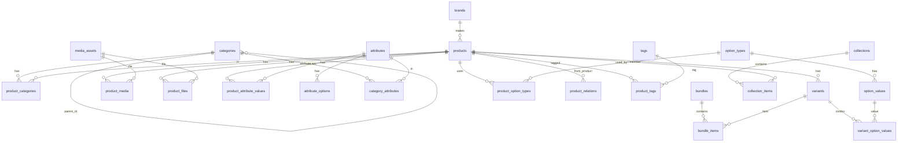

### 4.2 Pricing, campaigns, inventory

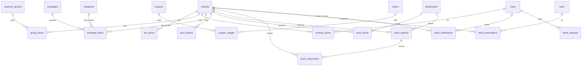

### 4.3 Customers and access

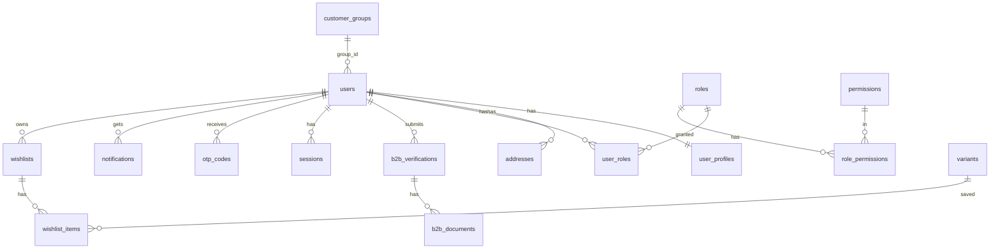

### 4.4 Sales

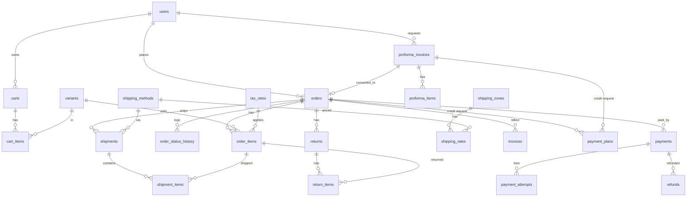

### 4.5 Engagement, content, system

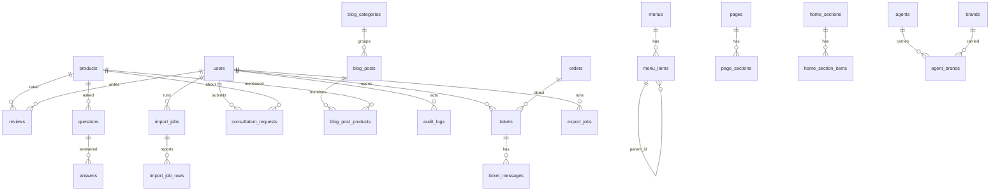

### 4.6 Relationship summary (for Prisma modelling)

| From | To | Cardinality | Notes |
|---|---|---|---|
| category | category | 1 → N | self reference, `path` ltree/materialized |
| category | product | N ↔ M | `product_categories` (`is_primary` flag, exactly one primary per product) |
| brand | product | 1 → N | brand required |
| product | variant | 1 → N | at least one variant (default variant for simple products) |
| variant | option_value | N ↔ M | `variant_option_values`, unique combination per product |
| category | attribute | N ↔ M | `category_attributes` (attribute set, inherited) |
| product | attribute | N ↔ M | `product_attribute_values` (typed value columns) |
| variant | warehouse | N ↔ M | `stock_levels` |
| variant | stock_batch | 1 → N | batch + expiry |
| variant | price rules | 1 → N | tier, group, contract, campaign |
| user | customer_group | N → 1 | decides group prices |
| user | order | 1 → N | guest orders have null user and guest contact fields |
| order | payment | 1 → N | multiple attempts / split payments |
| order | shipment | 1 → N | partial shipments |
| proforma | order | 1 → 0..1 | conversion |
| product | product | N ↔ M | `product_relations` (`related`, `alternative`, `complementary`) |
| bundle | variant | N ↔ M | `bundle_items` |

---

## 5. Database: table dictionary

`id`, `created_at`, `updated_at` exist on every table and are omitted below. `FK` = foreign key. `UQ` = unique. `NN` = not null.

### 5.1 Identity and access

**users**
| Column | Type | Notes |
|---|---|---|
| mobile | text UQ | normalized `09xxxxxxxxx`, primary login |
| email | text UQ null | |
| password_hash | text null | argon2 |
| first_name, last_name | text | |
| customer_group_id | FK customer_groups | default group `retail` |
| status | enum user_status | `active`, `blocked`, `pending` |
| account_type | enum | `individual`, `clinic`, `lab`, `student`, `agent`, `company` |
| mobile_verified_at, email_verified_at | timestamptz null | |
| last_login_at | timestamptz null | |
| marketing_consent | bool | |
| deleted_at | timestamptz null | anonymization marker |

**user_profiles** (1:1 users)
| Column | Type | Notes |
|---|---|---|
| medical_council_no | text null | شماره نظام پزشکی |
| specialty | text null | e.g. endodontist, general |
| clinic_name | text null | |
| company_name, economic_code, national_id, registration_no | text null | invoice data for companies |
| birth_date | date null | |
| avatar_media_id | FK media_assets null | |

**addresses**
| Column | Type | Notes |
|---|---|---|
| user_id | FK | |
| label | text | home, clinic… |
| recipient_name, recipient_mobile | text | |
| province, city | text | normalized to a provinces/cities reference list |
| postal_code | text(10) | |
| address_line | text | |
| lat, lng | numeric null | |
| is_default | bool | |

**roles** (`code UQ`, `name_fa`, `name_en`, `is_system`) · **permissions** (`code UQ` like `products.update`, `module`, `description_fa`) · **role_permissions** (`role_id`, `permission_id`, PK pair) · **user_roles** (`user_id`, `role_id`, PK pair).

**customer_groups**: `code UQ`, `name_fa`, `name_en`, `requires_approval bool`, `default_discount_percent numeric(5,2) null`, `min_order_amount bigint null`, `can_request_credit bool`, `show_prices bool`.
Seed: `retail`, `dentist`, `clinic`, `lab`, `student`, `agent`, `wholesale`.

**b2b_verifications**: `user_id FK`, `requested_group_id FK`, `status enum(pending, approved, rejected, needs_info)`, `reviewed_by FK users null`, `reviewed_at`, `reject_reason`, `note`.
**b2b_documents**: `verification_id FK`, `type enum(medical_card, business_license, clinic_license, national_card, other)`, `media_id FK`, `uploaded_at`.

**otp_codes**: `mobile`, `code_hash`, `purpose enum(login, register, reset, phone_change)`, `expires_at`, `attempts int`, `consumed_at`, `ip`. · **sessions**: `user_id`, `token_hash UQ`, `user_agent`, `ip`, `expires_at`, `revoked_at`.

### 5.2 Catalog

**categories**
| Column | Type | Notes |
|---|---|---|
| parent_id | FK self null | |
| path | text/ltree | materialized path, index (GiST/btree) |
| depth | smallint | |
| vertical | enum | default `dental` |
| name_fa NN, name_en | text | |
| slug | text UQ | |
| description_fa, seo_text_fa | text | short, useful SEO text only |
| image_media_id, icon_media_id | FK media_assets null | |
| meta_title, meta_description | text null | |
| sort_order | int | |
| is_active | bool | |
| show_in_menu, show_on_home | bool | |
| product_count_cache | int | refreshed by job |
| deleted_at | timestamptz null | |

**brands**: `name_fa`, `name_en`, `slug UQ`, `country_code char(2)`, `logo_media_id`, `description_fa`, `website`, `is_authorized_dealer bool`, `warranty_provider text`, `meta_title`, `meta_description`, `is_active`, `sort_order`, `vertical`, `deleted_at`.

**products**
| Column | Type | Notes |
|---|---|---|
| vertical | enum | |
| title_fa NN, title_en | text | both displayed |
| slug | text UQ | |
| brand_id | FK NN | |
| origin_country_code | char(2) | country of manufacture |
| primary_category_id | FK NN | must also exist in `product_categories` |
| kind | enum | `consumable`, `capital_equipment` |
| status | enum | `draft`, `active`, `out_of_stock`, `coming_soon`, `archived` |
| pricing_mode | enum | `fixed`, `range`, `call_for_price` |
| short_description_fa, description_fa | text | sanitized rich text |
| sku | text UQ | product-level code (variants have their own) |
| imed_code | text null | کد IMED, indexed |
| gtin | text null | |
| warranty_months | int null | |
| warranty_provider | text null | |
| warranty_terms_fa | text null | |
| installation_available | bool | |
| installation_fee | bigint null | |
| training_available | bool | |
| requires_prescription_license | bool | restricted sale flag (admin-defined policy) |
| min_order_qty, order_step | int | |
| allow_backorder | bool | |
| rating_avg, rating_count | numeric/int | maintained from approved reviews only |
| view_count, sold_count | bigint | statistic counters |
| published_at | timestamptz null | |
| meta_title, meta_description, canonical_url | text null | |
| search_text | text | normalized |
| deleted_at | timestamptz null | |

**product_categories**: `product_id`, `category_id`, `is_primary`, `sort_order`; PK (product_id, category_id); partial UQ (product_id) where is_primary.

**variants**
| Column | Type | Notes |
|---|---|---|
| product_id | FK | |
| sku | text UQ | |
| barcode | text null | |
| name_fa | text null | derived from options |
| base_price | bigint null | null when `call_for_price` |
| compare_at_price | bigint null | informational only, never used for fake discounts |
| cost_price | bigint null | admin only, hidden from storefront |
| weight_g | int null | for shipping |
| dimensions_mm | jsonb null | l, w, h |
| image_media_id | FK null | |
| is_default | bool | |
| is_active | bool | |
| track_stock | bool | |
| sort_order | int | |

**option_types** (`code`, `name_fa`, `name_en`, `display_type enum(dropdown, swatch, button)`) · **option_values** (`option_type_id`, `value_fa`, `value_en`, `color_hex`, `sort_order`) · **product_option_types** (`product_id`, `option_type_id`, `sort_order`) · **variant_option_values** (`variant_id`, `option_value_id`; UQ combination per product enforced in service layer + deferred constraint).

**attributes**: `code UQ`, `label_fa`, `label_en`, `type enum(text, number, select, multiselect, boolean, range)`, `unit`, `description_fa`.
**attribute_options**: `attribute_id`, `value_key`, `label_fa`, `label_en`, `color_hex null`, `sort_order`.
**category_attributes**: `category_id`, `attribute_id`, `is_required`, `is_filterable`, `is_comparable`, `show_in_spec`, `filter_widget enum(checkbox, range, toggle)`, `sort_order`, `group_label_fa null` (spec-table section).
**product_attribute_values**: `product_id`, `attribute_id`, `value_text`, `value_number numeric null`, `value_number_max numeric null` (for ranges), `value_bool null`, `option_id FK null`; multiselect = multiple rows. Index (attribute_id, value_number), (attribute_id, option_id).

**media_assets**: `bucket`, `key`, `kind enum(image, video, pdf, doc, other)`, `mime`, `size_bytes`, `width`, `height`, `alt_fa`, `blurhash`, `variants jsonb` (webp/avif sizes), `is_private bool`, `uploaded_by`.
**product_media**: `product_id`, `variant_id null`, `media_id`, `role enum(gallery, thumbnail, video, 360)`, `sort_order`.
**product_files**: `product_id`, `media_id`, `type enum(catalog, manual, certificate_ce, certificate_iso, certificate_fda, ministry_license, msds, other)`, `title_fa`, `issued_at null`, `expires_at null`, `is_public bool`.

**product_relations**: `product_id`, `related_product_id`, `type enum(related, alternative, complementary)`, `sort_order`; PK triple.
**tags** (`name_fa`, `slug UQ`) · **product_tags**.
**bundles**: `name_fa`, `slug UQ`, `description_fa`, `image_media_id`, `bundle_price bigint null` (null = sum of items minus `discount_percent`), `discount_percent numeric(5,2) null`, `status`, `kind enum(starter_pack, economy_pack, promo)`, `published_at`.
**bundle_items**: `bundle_id`, `variant_id`, `quantity`, `sort_order`.
**collections**: `code UQ`, `name_fa`, `slug UQ`, `type enum(manual, rule)`, `rule jsonb null` (e.g. `{"status":"new","days":30}`), `is_active`, `sort_order`. **collection_items**: `collection_id`, `product_id`, `sort_order`.

### 5.3 Pricing and campaigns

**tier_prices**: `variant_id`, `min_qty`, `unit_price`, `customer_group_id null`; UQ (variant, min_qty, group).
**group_prices**: `variant_id`, `customer_group_id`, `price`, `starts_at null`, `ends_at null`; UQ (variant, group).
**contract_prices**: `variant_id`, `user_id`, `price`, `starts_at`, `ends_at`, `note`, `created_by`.
**price_history**: `variant_id`, `field enum(base_price, group_price, tier_price, campaign_price)`, `old_value`, `new_value`, `changed_by`, `source enum(admin, import, api, campaign)`, `changed_at`. Append-only. Used to prove a discount is real (a discount may only display if the pre-discount price existed ≥ N days; N is a setting).
**campaigns**: `name_fa`, `slug UQ`, `type enum(percent, fixed, price_override, flash)`, `value`, `starts_at NN`, `ends_at NN`, `show_timer bool` (timer renders only if `ends_at` is in the future), `badge_text_fa`, `banner_media_id null`, `status enum(draft, scheduled, active, ended, cancelled)`, `priority int`, `stackable bool`, `customer_group_ids uuid[] null`, `max_qty_per_order null`.
**campaign_items**: `campaign_id`, `scope enum(variant, product, category, brand)`, `variant_id null`, `product_id null`, `category_id null`, `brand_id null`, `override_value null`.
**coupons**: `code UQ`, `type enum(percent, fixed, free_shipping)`, `value`, `min_order_amount`, `max_discount_amount`, `starts_at`, `ends_at`, `usage_limit`, `usage_limit_per_user`, `customer_group_ids uuid[] null`, `applies_to jsonb null`, `is_active`.
**coupon_usages**: `coupon_id`, `user_id null`, `order_id`, `discount_amount`, `used_at`.
**tax_rates**: `name_fa`, `rate_percent numeric(5,2)`, `is_default`, `applies_from`, `applies_to null` (VAT is configurable; never hardcode a rate).

### 5.4 Inventory

**warehouses**: `code UQ`, `name_fa`, `address`, `is_default`, `is_active`, `is_sellable bool`, `priority int`.
**stock_levels**: `variant_id`, `warehouse_id`, `on_hand int`, `reserved int`, `low_stock_threshold int`, `reorder_qty int null`, `allow_preorder bool`, `preorder_eta date null`; UQ (variant, warehouse); check `reserved <= on_hand` unless backorder. `available = on_hand - reserved` (computed).
**stock_batches**: `variant_id`, `warehouse_id`, `batch_no`, `produced_at date null`, `expires_at date null`, `qty_on_hand int`, `unit_cost bigint null`, `special_price bigint null`, `supplier_id FK null`, `received_at`; index (variant, expires_at) for FEFO.
**stock_movements** (append-only): `variant_id`, `warehouse_id`, `batch_id null`, `type enum(receipt, sale, return, adjustment, transfer_out, transfer_in, write_off, reservation_release)`, `qty_delta int`, `reference_type`, `reference_id`, `reason`, `created_by`.
**stock_reservations**: `variant_id`, `warehouse_id`, `cart_id null`, `order_id null`, `qty`, `expires_at`, `status enum(active, converted, expired, released)`.
**stock_notifications** (back-in-stock): `variant_id`, `user_id null`, `mobile null`, `email null`, `notified_at null`.
**stock_requests** (unavailable-item request): `user_id null`, `contact_name`, `mobile`, `title_text`, `brand_text null`, `description`, `attachment_media_id null`, `status enum(new, in_review, sourcing, available, rejected, closed)`, `assigned_to null`, `linked_product_id null`, `admin_note`.
**suppliers**: `name_fa`, `contact_name`, `mobile`, `email`, `address`, `note`, `is_active`.
**stocktakes**: `warehouse_id`, `status enum(draft, counting, reviewed, applied)`, `started_by`, `applied_at`; **stocktake_lines**: `stocktake_id`, `variant_id`, `batch_id null`, `system_qty`, `counted_qty`, `difference`.

### 5.5 Cart, orders, payments, shipping

**carts**: `user_id null`, `session_id null`, `status enum(active, converted, abandoned)`, `coupon_id null`, `currency`, `last_activity_at`, `abandoned_notified_at null`.
**cart_items**: `cart_id`, `variant_id`, `quantity`, `unit_price_snapshot`, `added_at`; UQ (cart, variant).

**orders**
| Column | Type | Notes |
|---|---|---|
| order_no | text UQ | human-readable, non-sequential-guessable |
| user_id | FK null | null = guest |
| guest_name, guest_mobile, guest_email | text null | |
| status | enum | see §8 |
| payment_status | enum | `unpaid`, `partially_paid`, `paid`, `refunded`, `partially_refunded`, `pending_credit` |
| fulfillment_status | enum | `unfulfilled`, `partial`, `fulfilled`, `returned` |
| payment_method | enum | `online`, `cash_on_delivery`, `bank_transfer`, `credit_request`, `cheque_request`, `installment_request` |
| subtotal, discount_total, shipping_total, tax_total, grand_total | bigint | |
| coupon_code | text null | |
| shipping_address | jsonb | snapshot |
| billing_info | jsonb | snapshot (company invoice data) |
| shipping_method_id | FK null | |
| customer_note, internal_note | text | |
| source | enum | `web`, `admin`, `proforma`, `phone` |
| proforma_id | FK null | |
| placed_at, paid_at, cancelled_at, completed_at | timestamptz null | |
| ip, user_agent | | fraud review |

**order_items**: `order_id`, `variant_id`, `product_title_snapshot`, `sku_snapshot`, `batch_id null`, `quantity`, `unit_price`, `discount_amount`, `tax_rate_id null`, `tax_amount`, `line_total`, `price_source enum(base, group, tier, contract, campaign, bundle)`.
**order_status_history**: `order_id`, `from_status`, `to_status`, `changed_by null`, `note`, `notified bool`.
**payments**: `order_id`, `gateway enum(zarinpal, idpay, ...)`, `method enum(online, card_to_card, cash, cheque, credit)`, `amount`, `status enum(initiated, redirected, pending_verify, verified, failed, cancelled, refunded)`, `authority`, `ref_id`, `card_pan_masked`, `paid_at`, `raw_callback jsonb`, `idempotency_key UQ`.
**payment_attempts**: `payment_id`, `request_payload`, `response_payload`, `http_status`, `error_code`, `created_at`.
**refunds**: `payment_id`, `return_id null`, `amount`, `status enum(requested, approved, processed, failed)`, `reason`, `processed_by`, `processed_at`.
**shipping_methods**: `code`, `name_fa`, `carrier enum(post, tipax, courier, pickup, freight, own_fleet)`, `is_active`, `estimated_days_min/max`, `free_over_amount null`.
**shipping_zones**: `name_fa`, `provinces text[]`. **shipping_rates**: `zone_id`, `method_id`, `min_weight_g`, `max_weight_g`, `price`.
**shipments**: `order_id`, `method_id`, `status enum(pending, packed, shipped, in_transit, delivered, failed, returned)`, `tracking_code`, `carrier`, `shipped_at`, `delivered_at`, `cost`, `address_snapshot jsonb`, `label_media_id null`. **shipment_items**: `shipment_id`, `order_item_id`, `quantity`, `batch_id null`.
**invoices**: `invoice_no UQ`, `order_id`, `type enum(sale, return)`, `buyer_snapshot jsonb`, `seller_snapshot jsonb`, `subtotal`, `tax_total`, `total`, `issued_at`, `pdf_media_id`, `status enum(issued, voided)`, `voided_reason`.
**proforma_invoices**: `proforma_no UQ`, `user_id null`, `contact snapshot`, `status enum(draft, sent, viewed, accepted, rejected, expired, converted)`, `valid_until`, `subtotal`, `discount_total`, `shipping_total`, `tax_total`, `grand_total`, `terms_fa`, `payment_terms_fa`, `created_by null` (staff), `source enum(customer_request, admin)`, `order_id null`, `pdf_media_id`, `sent_at`, `viewed_at`. **proforma_items**: `proforma_id`, `variant_id null`, `description`, `quantity`, `unit_price`, `discount_amount`, `line_total`.
**payment_plans** (credit/installment/cheque *requests*): `order_id null`, `proforma_id null`, `user_id`, `type enum(credit, installment, cheque)`, `requested_amount`, `installments_count null`, `proposed_terms_fa`, `status enum(submitted, under_review, needs_info, approved, rejected, active, settled, defaulted, cancelled)`, `reviewed_by`, `decision_note`, `approved_amount null`, `schedule jsonb null`, `documents jsonb`.
**returns**: `return_no UQ`, `order_id`, `user_id`, `status enum(requested, approved, rejected, awaiting_goods, received, inspected, refunded, closed)`, `reason enum(damaged, wrong_item, defective, expired, not_needed, other)`, `description`, `resolution enum(refund, replacement, credit)`. **return_items**: `return_id`, `order_item_id`, `quantity`, `condition enum(sealed, opened, damaged)`, `restock bool`.

### 5.6 Engagement and support

**reviews**: `product_id`, `user_id`, `order_item_id null` (verified purchase flag), `rating smallint 1..5`, `title`, `body`, `pros`, `cons`, `status enum(pending, approved, rejected)`, `is_verified_purchase`, `helpful_count`, `moderated_by`.
**questions**: `product_id`, `user_id null`, `body`, `status enum(pending, approved, rejected)`. **answers**: `question_id`, `user_id null`, `is_staff bool`, `body`, `status`.
**wishlists**: `user_id`, `name`. **wishlist_items**: `wishlist_id`, `product_id`, `variant_id null`.
Compare lists and recently-viewed are client/session state (Redis + cookie), persisted for logged-in users in `user_preferences jsonb` (no table needed).
**tickets**: `ticket_no UQ`, `user_id`, `order_id null`, `subject`, `department enum(sales, support, accounting, technical)`, `priority enum(low, normal, high, urgent)`, `status enum(open, pending_customer, pending_staff, resolved, closed)`, `assigned_to null`, `last_reply_at`, `sla_due_at null`. **ticket_messages**: `ticket_id`, `author_user_id`, `is_staff`, `body`, `attachments jsonb`.
**consultation_requests**: `user_id null`, `name`, `mobile`, `clinic_name`, `product_id null`, `category_id null`, `budget_range`, `message`, `preferred_contact_time`, `status enum(new, contacted, quoted, won, lost)`, `assigned_to`, `proforma_id null`.
**newsletter_subscribers**: `email null`, `mobile null`, `source`, `confirmed_at`, `unsubscribed_at`.
**notifications**: `user_id`, `channel enum(in_app, sms, email, push)`, `type`, `title_fa`, `body_fa`, `data jsonb`, `read_at`, `sent_at`.

### 5.7 Content and SEO

**blog_categories** (`name_fa`, `slug`, `parent_id`) · **blog_posts**: `title_fa`, `slug UQ`, `excerpt`, `body` (rich text/MDX), `cover_media_id`, `category_id`, `author_user_id`, `status enum(draft, scheduled, published, archived)`, `published_at`, `reading_minutes`, `meta_title`, `meta_description`, `faq jsonb null`, `view_count` · **blog_post_products**: `post_id`, `product_id`.
**pages**: `slug UQ`, `title_fa`, `body`, `status`, `template enum(default, about, contact, policy, landing)`, `meta_*`. **page_sections**: `page_id`, `type`, `data jsonb`, `sort_order`.
**banners**: `placement enum(home_hero, home_mid, category_top, sidebar, popup)`, `title_fa`, `image_desktop_media_id`, `image_mobile_media_id`, `link_url`, `alt_fa`, `starts_at`, `ends_at`, `sort_order`, `is_active`, `view_count`, `click_count`.
**home_sections**: `type enum(banners, categories, products_collection, brands, bundles, blog, agents, trust, custom_html)`, `title_fa`, `config jsonb`, `sort_order`, `is_active`. **home_section_items**: `section_id`, `ref_type`, `ref_id`, `sort_order`.
**menus**: `code UQ (main, footer_1, footer_2, mobile)`, `name`. **menu_items**: `menu_id`, `parent_id`, `type enum(category, brand, page, url, collection)`, `ref_id`, `label_fa`, `url`, `icon_media_id`, `badge_text`, `sort_order`, `is_active`, `open_in_new_tab`.
**faqs**: `scope enum(global, category, product)`, `ref_id`, `question_fa`, `answer_fa`, `sort_order`.
**agents** (provincial agents/branches): `name_fa`, `type enum(agent, branch, partner)`, `province`, `city`, `address`, `phone`, `mobile`, `lat`, `lng`, `working_hours jsonb`, `is_active`, `sort_order`. **agent_brands**: `agent_id`, `brand_id`.
**redirects**: `from_path UQ`, `to_path`, `status_code smallint (301/302/410)`, `hit_count`, `created_by`, `is_auto bool`.
**seo_templates**: `entity enum(product, category, brand, blog_post, page)`, `title_template`, `description_template`, `og_template`, `robots_default` (variables like `{title_fa}`, `{brand}`, `{category}`, `{price_from}`); **seo_overrides**: `entity`, `entity_id`, `meta_title`, `meta_description`, `canonical_url`, `robots`, `og_image_media_id`.
**not_found_log**: `path`, `referrer`, `hit_count`, `first_seen_at`, `last_seen_at`, `resolved_redirect_id null`.
**site_settings**: `key UQ`, `value jsonb`, `group` (general, seo, payment, shipping, sms, email, tax, social, trust, analytics, checkout), `is_secret bool`, `updated_by`.
**trust_badges**: `type enum(enamad, samandehi, imed, custom)`, `title_fa`, `embed_html`, `image_media_id`, `link_url`, `is_active` (embed HTML is sanitized, admin-only).
**social_links**: `platform`, `url`, `is_active` (only active ones with a valid URL render).

### 5.8 System

**audit_logs** (append-only): `actor_user_id`, `action` (e.g. `product.update`), `entity_type`, `entity_id`, `before jsonb`, `after jsonb`, `ip`, `user_agent`, `request_id`.
**import_jobs**: `type enum(products, variants, prices, stock, categories, brands, attributes, customers)`, `file_media_id`, `mode enum(create_only, update_only, upsert)`, `status` (see §8), `total_rows`, `processed_rows`, `success_rows`, `error_rows`, `warning_rows`, `started_at`, `finished_at`, `error_report_media_id`, `created_by`, `options jsonb`.
**import_job_rows**: `job_id`, `row_number`, `status enum(ok, warning, error, skipped)`, `entity_key`, `message_fa`, `raw jsonb`.
**export_jobs**: `type`, `filters jsonb`, `columns jsonb`, `format enum(xlsx, csv)`, `status`, `file_media_id`, `created_by`, `expires_at`.
**search_synonyms**: `terms text[]`, `type enum(equivalent, one_way)`, `is_active`. **search_queries_log**: `query`, `normalized`, `results_count`, `user_id null`, `clicked_entity null`, `created_at` (drives "zero-result searches" report).
**sms_logs / email_logs**: `provider`, `to`, `template`, `payload`, `status`, `provider_message_id`, `error`, `sent_at`.
**webhook_events**: `source`, `event_type`, `payload`, `signature_ok`, `processed_at`, `error`.
**feature_flags**: `key UQ`, `enabled`, `rollout jsonb`.
**scheduled_jobs_runs**: `job_name`, `started_at`, `finished_at`, `status`, `message` (queue monitor).
**analytics_daily** (pre-aggregated for dashboard speed): `date`, `metric`, `dimension_type null`, `dimension_id null`, `value numeric`; metrics such as `orders_count`, `revenue`, `visitors`, `add_to_cart`, `checkout_started`, `conversion`.

---

## 6. Enums and indexes

### 6.1 Core enums
`user_status`, `account_type`, `product_kind`, `product_status`, `pricing_mode`, `order_status`, `payment_status`, `fulfillment_status`, `payment_method`, `shipment_status`, `proforma_status`, `return_status`, `ticket_status`, `payment_plan_status`, `campaign_status`, `import_status`, `vertical`. Values are defined in the table notes above and in the state machines in §8.

### 6.2 Required indexes (with reason)

| Table | Index | Reason |
|---|---|---|
| categories | UQ(slug); btree(parent_id); GiST/btree(path) | tree queries, breadcrumbs, descendants |
| products | UQ(slug), UQ(sku), btree(imed_code), btree(brand_id), btree(primary_category_id), btree(status, published_at), GIN(search_text trigram) fallback | listing, lookup, admin search |
| product_categories | PK(product_id, category_id), btree(category_id, sort_order), partial UQ(product_id) where is_primary | category pages, one primary |
| variants | UQ(sku), btree(barcode), btree(product_id) | scan and join |
| product_attribute_values | btree(product_id), btree(attribute_id, option_id), btree(attribute_id, value_number) | facets |
| stock_levels | UQ(variant_id, warehouse_id), btree(warehouse_id) where available low | low-stock report |
| stock_batches | btree(variant_id, expires_at), btree(expires_at) | FEFO, expiry report |
| stock_movements | btree(variant_id, created_at), btree(reference_type, reference_id) | audit trail |
| group_prices / tier_prices | UQ composite as defined | price resolution |
| price_history | btree(variant_id, changed_at) | discount proof |
| campaigns | btree(status, starts_at, ends_at) | active campaign lookup |
| orders | UQ(order_no), btree(user_id, placed_at desc), btree(status, placed_at desc), btree(payment_status), btree(placed_at) | account page, admin lists, reports |
| order_items | btree(order_id), btree(variant_id) | joins, best sellers |
| payments | UQ(idempotency_key), btree(order_id), btree(authority) | callback matching |
| carts | btree(user_id, status), btree(last_activity_at) where status=active | abandoned-cart job |
| reviews | btree(product_id, status), btree(status, created_at) | storefront, moderation queue |
| tickets | btree(status, assigned_to), btree(user_id) | support queue |
| redirects | UQ(from_path) | middleware lookup |
| audit_logs | btree(entity_type, entity_id), btree(actor_user_id, created_at), btree(created_at) | forensic queries |
| import_job_rows | btree(job_id, status) | error preview |
| otp_codes | btree(mobile, created_at), btree(expires_at) | abuse limits, cleanup |
| analytics_daily | UQ(date, metric, dimension_type, dimension_id) | dashboard charts |

Partition `audit_logs`, `stock_movements`, `search_queries_log`, `analytics_daily` by month once row counts exceed ~50 M.

---

## 7. Search index (Meilisearch)

### 7.1 Persian normalization pipeline (applied to indexed text **and** to queries)
1. Unicode NFKC.
2. Arabic → Persian letters: `ي→ی`, `ك→ک`, `ة→ه`, `ؤ→و`, `أ/إ→ا`; `ۀ→ه`.
3. Remove tatweel/kashida `U+0640` and diacritics (tashkeel).
4. Digits: Persian (`۰-۹`) and Arabic-Indic (`٠-٩`) → ASCII `0-9` in the index; display re-localizes.
5. ZWNJ (`U+200C`): index **both** variants (with ZWNJ and with a space) so "می‌شود" and "میشود" match.
6. Lower-case Latin; collapse whitespace; strip punctuation.
7. Transliteration helper table for common brand names (e.g. `ووداکر, ودپکر → woodpecker`, `کوکسو → coxo`) managed as synonyms in the dashboard.

### 7.2 Index `products` document
```json
{
  "id": "product uuid",
  "sku": "…", "variant_skus": ["…"], "imed_code": "…", "gtin": "…",
  "title_fa": "…", "title_en": "…", "slug": "…",
  "brand": {"id": "…", "name_fa": "…", "name_en": "…", "slug": "…"},
  "origin_country": "DE",
  "category_ids": ["…"], "category_paths": ["…"], "primary_category_id": "…",
  "kind": "consumable",
  "status": "active", "in_stock": true,
  "price_from": 1200000, "price_to": 1500000, "pricing_mode": "range",
  "group_prices": {"dentist": 1100000, "clinic": 1050000},
  "has_discount": true, "discount_percent": 12, "campaign_ends_at": 1790000000,
  "near_expiry": false,
  "attrs": {"shade": ["A2"], "pack_count": 5, "taper": ["4%"], "is_cordless": true},
  "rating_avg": 4.6, "rating_count": 18, "sold_count": 240, "view_count": 5300,
  "created_at": 1760000000, "published_at": 1760000000,
  "image": "…", "search_text": "normalized"
}
```
Per-group prices are indexed so group-aware sort/filter needs no extra DB query; the storefront resolves the viewer's group server-side.

### 7.3 Settings
| Setting | Value |
|---|---|
| searchableAttributes (in order) | `title_fa`, `title_en`, `sku`, `variant_skus`, `imed_code`, `brand.name_fa`, `brand.name_en`, `category names`, `search_text` |
| filterableAttributes | `brand.id`, `origin_country`, `category_ids`, `category_paths`, `kind`, `in_stock`, `has_discount`, `near_expiry`, `price_from`, `rating_avg`, `attrs.*` (generated from `category_attributes.is_filterable`) |
| sortableAttributes | `price_from`, `created_at`, `sold_count`, `view_count`, `rating_avg`, `discount_percent` |
| typoTolerance | enabled; min word size for one typo 4, two typos 8; disabled on `sku`, `imed_code` |
| synonyms | from `search_synonyms` |
| stopWords | short list of Persian function words managed in dashboard |
| faceting.maxValuesPerFacet | 200; sort facets by count |
| pagination.maxTotalHits | 10 000 (use cursor/offset UI limits) |

Secondary indexes: `categories`, `brands`, `blog_posts`, `pages` (for the global search suggestions).
Sync: DB change → outbox table → BullMQ worker → idempotent upsert; full reindex job available from the dashboard (with progress and zero-downtime swap).

---

## 8. State machines

### 8.1 Order
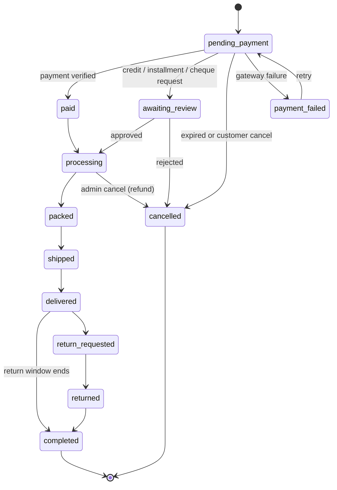
Persian labels: `pending_payment` در انتظار پرداخت · `awaiting_review` در انتظار بررسی · `payment_failed` پرداخت ناموفق · `paid` پرداخت‌شده · `processing` در حال پردازش · `packed` بسته‌بندی‌شده · `shipped` ارسال‌شده · `delivered` تحویل‌شده · `completed` تکمیل‌شده · `cancelled` لغوشده · `return_requested` درخواست مرجوعی · `returned` مرجوع‌شده.

### 8.2 Payment
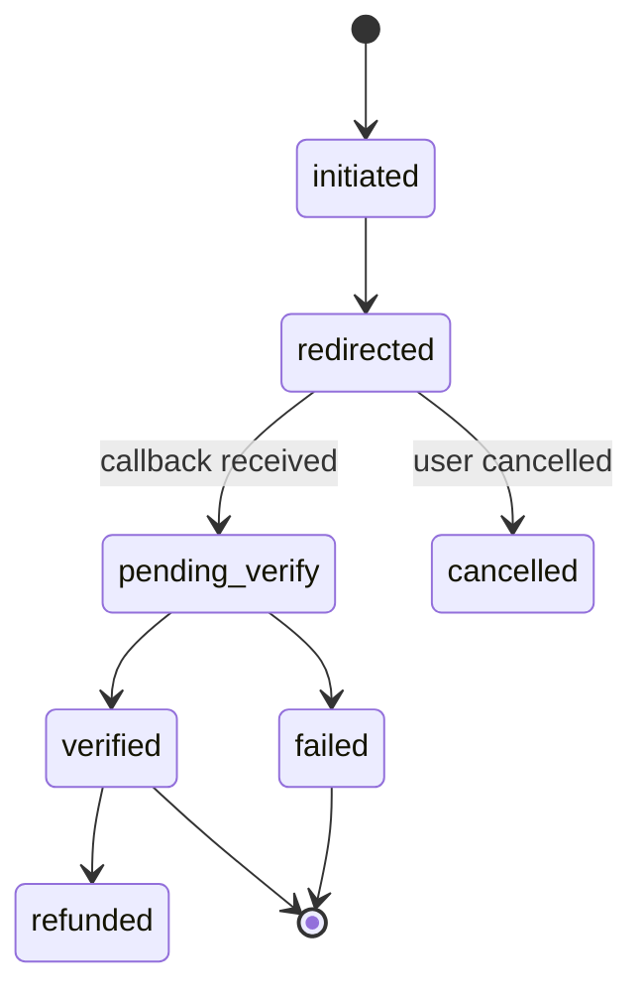
Rules: never mark `verified` without a server-side Verify call; the `idempotency_key` prevents double processing; unverified callbacks are logged in `webhook_events`.

### 8.3 Proforma invoice
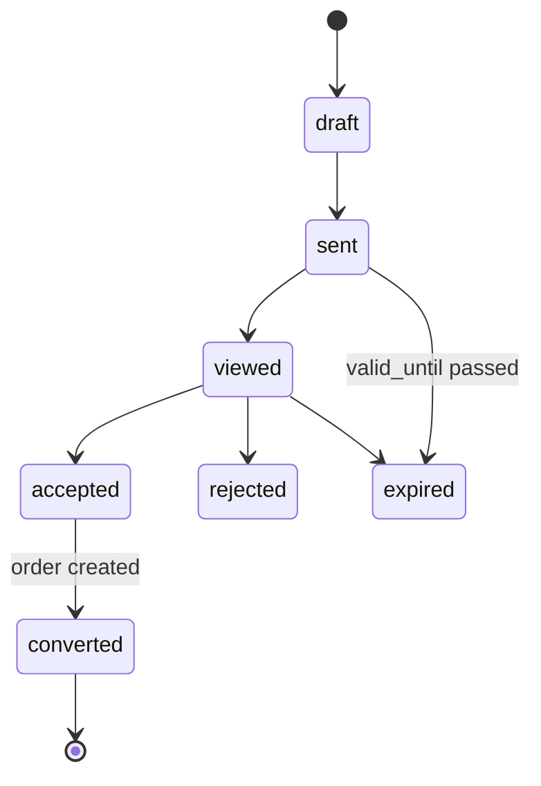
Persian: `draft` پیش‌نویس · `sent` ارسال‌شده · `viewed` مشاهده‌شده · `accepted` تأییدشده · `rejected` ردشده · `expired` منقضی · `converted` تبدیل به سفارش.

### 8.4 Return
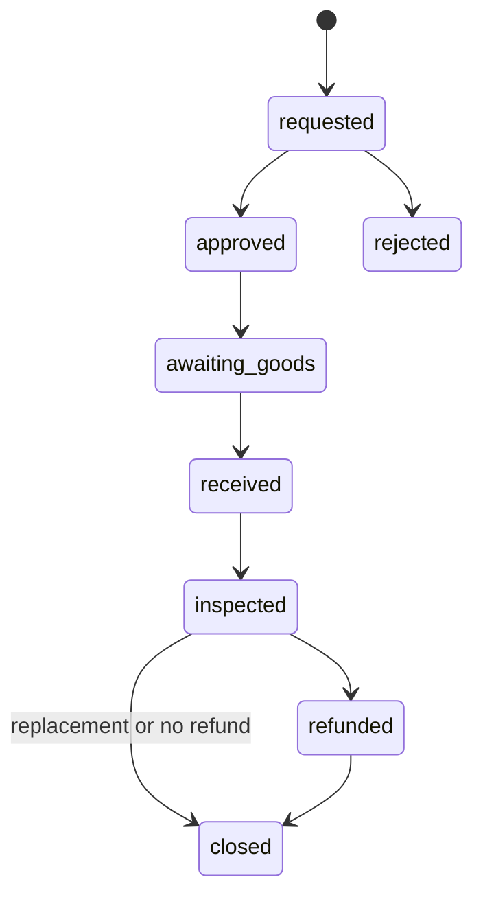

### 8.5 Payment plan (credit / installment / cheque request)
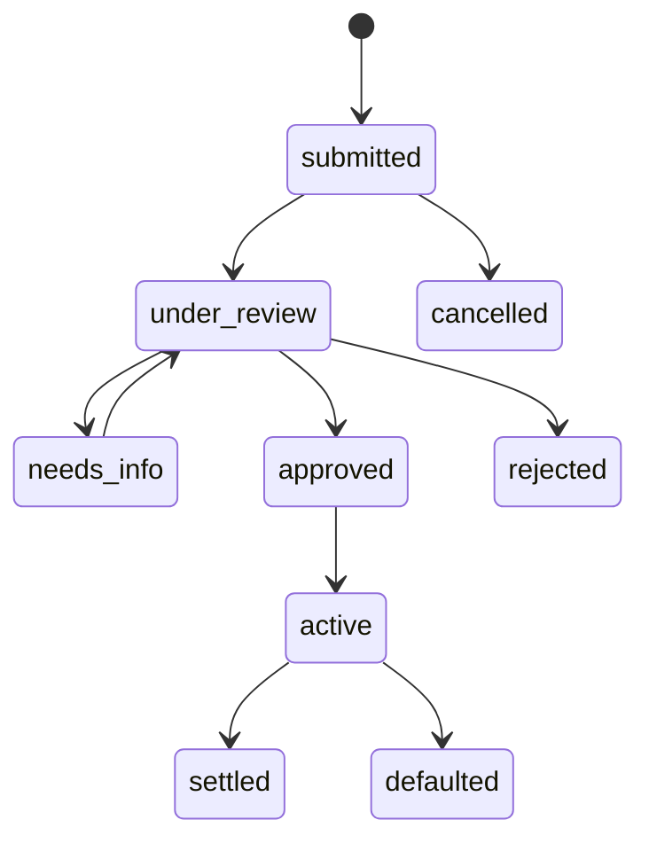

### 8.6 B2B verification
`pending → approved | rejected | needs_info`; `needs_info → pending` after the customer uploads more documents. Approval moves the user to the requested `customer_group` and logs to `audit_logs`.

### 8.7 Import job
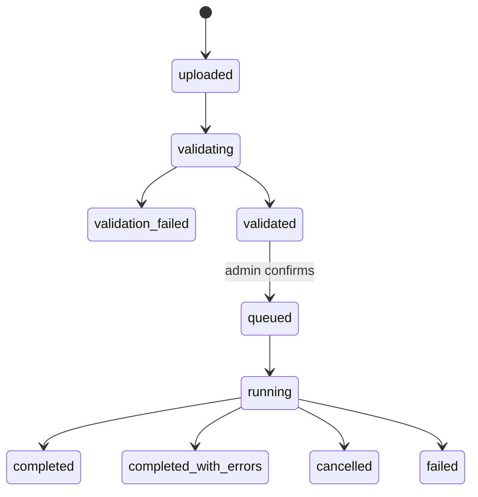
Validation is a dry run: it writes `import_job_rows` with `ok/warning/error` and **changes nothing** in the catalog.

### 8.8 Campaign
`draft → scheduled → active → ended`; `cancelled` from any pre-ended state. A scheduler flips `scheduled→active` at `starts_at` and `active→ended` at `ends_at`, then invalidates caches and re-indexes affected products.

---

## 9. Admin dashboard: information architecture

All labels Persian, RTL. Sidebar groups (icon + label), collapsible; items are shown only if the user has `*.view` permission.

| Group (fa) | Items (fa) |
|---|---|
| **داشبورد** | نمای کلی · گزارش‌ها |
| **کاتالوگ** | محصولات · دسته‌بندی‌ها · برندها · ویژگی‌ها و مجموعه ویژگی · گزینه‌های تنوع (variant) · بسته‌ها و پک‌ها · مجموعه‌ها (collections) · برچسب‌ها · کتابخانه رسانه |
| **قیمت و تخفیف** | قیمت گروه‌های مشتری · قیمت پلکانی · قیمت قراردادی · کمپین‌ها · کوپن‌ها · تاریخچه قیمت · ویرایش گروهی قیمت |
| **انبار** | موجودی · بچ‌ها و انقضا · حرکات انبار · انبارها · تأمین‌کنندگان · انبارگردانی · رزروها · درخواست کالاهای ناموجود · اطلاع‌رسانی موجودی |
| **فروش** | سفارش‌ها · پیش‌فاکتورها · فاکتورها · پرداخت‌ها · درخواست‌های اعتباری/اقساطی/چکی · مرسوله‌ها · مرجوعی‌ها · سبدهای رهاشده |
| **مشتریان** | کاربران · تأیید حساب حرفه‌ای (B2B) · گروه‌های مشتری · آدرس‌ها |
| **پشتیبانی** | تیکت‌ها · درخواست مشاوره · نظرات · پرسش و پاسخ |
| **محتوا** | بلاگ · صفحات · بنرها · بخش‌های صفحه اصلی · منوها · سوالات متداول · نمایندگان و شعب · نمادهای اعتماد · شبکه‌های اجتماعی |
| **بازاریابی** | خبرنامه · پیامک گروهی · اعلان‌ها · کمپین‌ها (لینک) |
| **سئو** | قالب‌های سئو · بازنویسی سئو · ریدایرکت‌ها · لاگ ۴۰۴ · سایت‌مپ · بررسی Schema |
| **ورود و خروج داده** | ایمپورت · اکسپورت · قالب‌های فایل · تاریخچه عملیات |
| **سیستم** | کاربران ادمین · نقش‌ها و دسترسی‌ها · تنظیمات · لاگ فعالیت (Audit) · مانیتور صف‌ها · ابزار جستجو (ایندکس و مترادف‌ها) · پشتیبان‌گیری · سلامت سیستم |

Global shell: top bar with Cmd/Ctrl+K global search (orders by number/mobile, products by SKU/IMED/name, users, tickets), notification bell, quick-create (+) menu (product, order, proforma, coupon, post), Jalali date, dark mode toggle, user menu.

---

## 10. Admin dashboard home

Date-range picker (Jalali) with presets: امروز، دیروز، ۷ روز، ۳۰ روز، این ماه، ماه قبل، سه ماهه، امسال، سفارشی. Every KPI and chart honors the range and shows comparison to the previous period (Δ%). All numbers are formatted in Persian digits with thousands separators; money in Toman.

### 10.1 KPI cards

| id | Persian label | Definition | Compare | Click-through |
|---|---|---|---|---|
| `kpi_revenue` | فروش خالص | Σ `grand_total` of paid orders − refunds | prev period | Sales report |
| `kpi_orders` | تعداد سفارش | orders placed (excluding cancelled) | prev period | Orders list |
| `kpi_aov` | میانگین ارزش سفارش | revenue / paid orders | prev period | Sales report |
| `kpi_new_customers` | مشتریان جدید | new verified users | prev period | Users |
| `kpi_conversion` | نرخ تبدیل | purchases / sessions | prev period | Funnel chart |
| `kpi_pending_orders` | سفارش‌های در انتظار اقدام | status in (`paid`,`processing`,`awaiting_review`) | live | Orders filtered |
| `kpi_unpaid` | سفارش‌های پرداخت‌نشده | `pending_payment` older than 1 h | live | Orders filtered |
| `kpi_proformas_open` | پیش‌فاکتورهای باز | `sent`/`viewed` not expired | live | Proformas |
| `kpi_b2b_pending` | حساب‌های در انتظار تأیید | `b2b_verifications.status = pending` | live | B2B queue |
| `kpi_tickets_open` | تیکت‌های باز | status open/pending_staff | live | Tickets |
| `kpi_low_stock` | کالاهای کم‌موجودی | available ≤ threshold | live | Low-stock report |
| `kpi_near_expiry` | کالاهای نزدیک انقضا | batches expiring within N days (setting) | live | Expiry report |
| `kpi_stock_value` | ارزش موجودی انبار | Σ on_hand × cost_price | prev snapshot | Stock valuation |
| `kpi_stock_requests` | درخواست کالای ناموجود | status new | live | Stock requests |
| `kpi_returns_open` | مرجوعی‌های باز | not closed | live | Returns |
| `kpi_refund_rate` | نرخ مرجوعی | returned value / revenue | prev period | Returns report |
| `kpi_gateway_success` | موفقیت پرداخت آنلاین | verified / initiated | prev period | Payments |

### 10.2 Charts (each has: title, type, axes, data source, interactions)

| id | Persian title | Chart type | X | Y / series | Default range | Source | Interaction |
|---|---|---|---|---|---|---|---|
| `ch_sales_trend` | روند فروش | Line + area (dual axis) | day/week/month toggle | revenue (area), orders (line); compare toggle | 30 days | `analytics_daily` | hover tooltip, drill to day's orders |
| `ch_orders_by_status` | سفارش‌ها بر اساس وضعیت | Donut | – | count per status | range | `orders` | click → filtered list |
| `ch_top_products` | پرفروش‌ترین محصولات | Horizontal bar (top 10) | revenue or qty toggle | product | range | `order_items` | click → product |
| `ch_top_categories` | فروش بر اساس دسته | Treemap | – | revenue by category | range | `order_items`+categories | click → category report |
| `ch_top_brands` | فروش بر اساس برند | Bar (top 10) | brand | revenue | range | `order_items` | click → brand |
| `ch_sales_by_group` | فروش بر اساس گروه مشتری | Stacked bar | month | revenue per group | 6 months | `orders`+users | legend toggle |
| `ch_b2b_b2c` | سهم B2B و B2C | Stacked area | week | revenue split | 90 days | `orders` | – |
| `ch_sales_by_province` | فروش بر اساس استان | Map (choropleth) + table | – | revenue / orders | range | shipping address | click → province |
| `ch_customer_growth` | رشد مشتریان | Line | week | new / returning customers | 90 days | `users`,`orders` | – |
| `ch_funnel` | قیف خرید | Funnel | stages | visits → product view → add to cart → checkout → purchase | range | `analytics_daily` | stage drop-off % |
| `ch_traffic_search` | جستجوها | Bar + table | day | searches, zero-result searches | 30 days | `search_queries_log` | click → zero-result list |
| `ch_stock_health` | سلامت موجودی | Stacked bar | category | in stock / low / out | live | `stock_levels` | click → inventory filtered |
| `ch_expiry_risk` | ریسک انقضا | Column (buckets) | 0–30, 31–60, 61–90, 91–180 days | value at cost | live | `stock_batches` | click → batches |
| `ch_payments_methods` | روش‌های پرداخت | Donut | – | share by method / gateway | range | `payments` | – |
| `ch_payment_success` | موفقیت درگاه‌ها | Line | day | success rate per gateway | 30 days | `payments` | – |
| `ch_discount_impact` | اثر کمپین‌ها و کوپن‌ها | Bar + line | campaign | revenue vs discount given | range | `campaigns`,`coupon_usages` | – |
| `ch_returns` | مرجوعی‌ها | Bar | reason | count / value | range | `returns` | – |
| `ch_ticket_sla` | وضعیت تیکت‌ها | Stacked bar | department | open/overdue/closed; avg response time line | 30 days | `tickets` | – |
| `ch_proforma_conversion` | تبدیل پیش‌فاکتور | Funnel | stages | sent → viewed → accepted → converted | 90 days | `proforma_invoices` | – |
| `ch_sales_heatmap` | ساعت و روز پرفروش | Heatmap | hour × weekday | orders | 90 days | `orders` | – |
| `ch_abandoned_carts` | سبدهای رهاشده | Line | day | abandoned count, recovered value | 30 days | `carts` | – |

### 10.3 Action tables on the home page (live, 5–10 rows each, "view all" link)

| Table (fa) | Columns | Row action |
|---|---|---|
| آخرین سفارش‌ها | order no, customer, group, total, payment status, status, time | open |
| کم‌موجودی | product, SKU, available, threshold, warehouse | reorder / adjust |
| نزدیک انقضا | product, batch, expiry (Jalali), qty, days left | set special price |
| پیش‌فاکتورهای در انتظار | no, customer, amount, valid until, status | follow up |
| حساب‌های منتظر تأیید | user, requested group, docs count, submitted at | review |
| تیکت‌های بی‌پاسخ | no, subject, customer, department, waiting time | reply |
| درخواست کالای ناموجود | title, customer, brand, age | assign |
| پرداخت‌های ناموفق/معلق | order, gateway, amount, error | retry verify |
| نظرات و پرسش‌های در انتظار | type, product, excerpt | approve/reject |
| عملیات ایمپورت در حال اجرا | file, type, progress bar, errors | open |
| هشدارهای سیستم | queue failures, search index lag, backup status, low disk | open |

---

## 11. Admin modules: tables, filters, actions

Every list = server-side paginated data table with: column chooser, density toggle, saved filters, sticky header, multi-sort, search box, row checkbox + bulk bar, Excel/CSV export of **current filter**, empty/loading/error states. Every detail page = tabs, unsaved-changes guard, audit trail tab, "view on storefront" link.

### 11.1 Products
- **List columns:** thumbnail, title (fa + en), SKU, IMED, brand, primary category, kind, price (range/"call"), stock (available), status, rating, updated at, ⋯ actions.
- **Filters:** search (title/SKU/IMED/barcode), category (tree, include children), brand, kind, status, stock state (in/low/out), has discount, has no image, has no description, missing IMED, price range, created/updated date, vertical.
- **Row actions:** edit, duplicate, view on site, archive, delete (soft).
- **Bulk actions:** change status, change category, add/remove tags, set brand, set warranty, change price by % or fixed, set stock threshold, export, archive, re-index.
- **Detail tabs:** ۱) اطلاعات اصلی ۲) دسته‌بندی‌ها ۳) ویژگی‌ها (dynamic form from the attribute set) ۴) تنوع‌ها و قیمت (variant matrix generator, per-variant SKU/price/stock/image) ۵) قیمت‌گذاری (group, tier, contract, campaigns affecting) ۶) موجودی و بچ‌ها ۷) تصاویر و ویدیو (drag-drop order, alt text) ۸) فایل‌ها و مدارک (catalog, CE/ISO/FDA, licences) ۹) گارانتی و نصب ۱۰) محصولات مرتبط/جایگزین/مکمل ۱۱) سئو (live SERP preview, OG preview, schema preview) ۱۲) نظرات و پرسش‌ها ۱۳) تاریخچه تغییرات.
- **Validation rules:** price required unless `call_for_price`; at least one image to publish; `imed_code` format check; spec-table required attributes enforced; slug uniqueness.

### 11.2 Categories
Drag-and-drop tree (move, reorder, indent), inline rename, counts of products, toggle active/menu/home. Edit panel: names, slug, image/icon, SEO text, meta, attribute set editor (add/remove/reorder, flags filterable/comparable/spec, inheritance indicator), preview of the generated filter sidebar. Safe delete flow: choose a target category for orphaned products. Merge categories tool.

### 11.3 Brands
Columns: logo, name fa/en, country, products count, authorized dealer, active. Filters: country, active. Tabs: info, SEO, products, certificates (brand-level documents), agents carrying it.

### 11.4 Attributes and attribute sets
Attribute list (code, label, type, unit, used-in categories count). Edit: options manager (drag order, color swatch for shades), unit, validation range. Attribute-set matrix view: categories × attributes grid with flag toggles. Impact warning on delete (shows affected products).

### 11.5 Variant options, bundles, collections, tags, media
- Options: option types and values with swatches.
- Bundles/starter packs: items picker with quantity, computed total vs bundle price, margin warning, storefront preview.
- Collections: manual or rule-based (rule builder with preview count).
- Media library: grid/list, filter by type/unused/missing alt, bulk alt-text editor, usage tracking ("used in N products"), safe delete.

### 11.6 Pricing and campaigns
- Group prices: matrix (variants × customer groups), inline edit, import.
- Tier prices: table per variant with min qty steps.
- Contract prices: customer-specific, with validity dates.
- Campaigns: create wizard (type, value, scope picker for variants/products/categories/brands, groups, schedule, timer on/off, badge text, banner); calendar view of overlapping campaigns; conflict detector; live preview of affected products; status flow `draft→scheduled→active→ended`.
- Coupons: code generator, usage limits, per-group, usage table.
- Price history: per variant chart + table (who/when/source).
- Bulk price edit: select by filter, apply % / fixed / rounding rule (e.g. round to nearest 1 000), preview diff, confirm, background job, undo (stores previous values).

### 11.7 Inventory
- **Stock levels:** variant, SKU, warehouse, on hand, reserved, available, threshold, status chip, next expiry. Inline adjust with reason (writes `stock_movements`). Filters: warehouse, low, out, overstock, category, brand.
- **Batches & expiry:** batch, expiry (Jalali), days left, qty, cost, special price; filters by days-left bucket; action "apply near-expiry price".
- **Movements ledger:** filter by type/date/user/reference.
- **Warehouses, suppliers:** CRUD.
- **Stocktake:** create session → count sheet (print/export) → enter counts → review differences → apply adjustments.
- **Reservations:** view active cart/order reservations, force release.
- **Unavailable-item requests:** kanban or table (`new → in_review → sourcing → available → closed`), assign, link to product, "notify customer".
- **Back-in-stock subscriptions:** per variant counts; "notify all now".
- **Reorder suggestions:** based on sales velocity and threshold (table with suggested qty).

### 11.8 Orders
- **List columns:** order no, date (Jalali), customer (name, group badge), items count, total, payment status chip, order status chip, method, shipping, province, assigned to.
- **Filters:** status, payment status, method, date range, amount range, customer group, province, has note, coupon, source, guest/member, search (order no/mobile/name/SKU).
- **Bulk actions:** change status, print invoices / picking lists / labels, export, assign.
- **Detail page:** header with status stepper (§8.1); customer card (with group, lifetime value, link to profile); items table (batch shown, price source badge); totals breakdown; payments panel (attempts, verify again, add manual payment, refund); shipments panel (create shipment, tracking code, partial ship); invoice panel (issue/void/download PDF); timeline (status history + notes + audit); notes (internal vs customer-visible); actions (cancel with restock, create return, duplicate, convert from/to proforma).
- **Manual order creation (phone sales):** customer picker, product picker with live group price, shipping, payment method, send payment link by SMS.

### 11.9 Proforma invoices
List: no, customer, total, valid until, status, owner. Detail: editable line items (product picker or free text), per-line discount, shipping, terms, validity, notes; **"send" via SMS/email with a public link**; customer can view/accept/reject online; PDF preview/download (Persian, RTL); convert to order; clone; expiry reminders. Source badge (customer request vs staff-created).

### 11.10 Payments, payment plans, shipments, returns, abandoned carts
- Payments: table with gateway/ref id/status/amount/order; actions verify-again, refund, export; reconciliation view (day totals per gateway vs orders).
- Payment plans (credit/installment/cheque): queue with status, requested amount, customer group, documents; detail with review form (approve amount, terms, schedule, reject with reason, request more info); schedule table when active; overdue flags.
- Shipments: list by status/carrier; bulk "mark shipped" with tracking import; label printing.
- Returns: queue with reason, items, photos; workflow actions per §8.4; restock toggle; refund creation.
- Abandoned carts: list (customer/contact, value, age, items), action "send reminder SMS/email", recovered-value stat.

### 11.11 Customers
- **Users list:** name, mobile, email, group, type, orders count, lifetime value, last order, registered at, status, B2B status.
- **Filters:** group, type, status, province, has orders, spent range, registered date, unverified.
- **Detail tabs:** profile (professional info), addresses, orders, proformas, tickets, wishlist, documents, group price overrides/contract prices, activity log. Actions: block/unblock, change group, reset password/OTP, impersonate (audited, read-only mode), anonymize on request.
- **B2B approval queue:** documents viewer (image/PDF zoom), approve/reject/needs-info with templated messages, auto SMS.
- **Customer groups:** CRUD, rules (requires approval, discount, min order, credit allowed, show prices), member counts.

### 11.12 Support
Tickets (SLA timers, canned replies, internal notes, assign, merge, convert to order note); consultation requests (pipeline `new→contacted→quoted→won/lost`, one-click create proforma); reviews moderation (approve/reject/bulk, spam filter hints, verified-purchase badge, reply as store); Q&A moderation (answer inline, mark staff).

### 11.13 Content
Blog (editor with preview, scheduling, product mentions, FAQ block, SEO panel); pages; banners (desktop+mobile image, schedule, placement, click stats); **home sections builder** (drag-drop ordering, per-section config, live preview, enable/disable); menus builder (tree, items from categories/brands/pages/collections, badges); FAQs; agents and branches (table + map picker); trust badges (embed sanitized); social links (render only if valid).

### 11.14 Marketing
Newsletter subscribers (export, unsubscribe); SMS campaigns (audience by group/segment, template, schedule, cost estimate, delivery report); notifications (templates and logs).

### 11.15 SEO tools
Meta templates with variable chips and live preview; per-entity overrides; redirect manager (CSV import, loop detection, hit counts, 301/302/410); 404 log with "create redirect" shortcut; sitemap status (last generated, URL counts per sitemap file, regenerate); **Schema & meta health check** table: pages missing H1 / having multiple H1, empty meta description, meta containing technical junk, non-absolute `og:image`, images without alt, duplicate titles, filter URLs indexable by mistake. This table must flag exactly the competitor errors listed in the main prompt.

### 11.16 Import / Export
See §13. Screens: new import wizard (upload → map columns → validate (dry-run) → preview errors table with row filters and downloadable error file → confirm → progress page with live counters → result report), history table, templates download, export builder (choose entity, filters, columns, format).

### 11.17 System
- Admin users and roles: role editor with permission checklist grouped by module; users list with last login, 2FA status; force logout.
- **Settings** (grouped): general (store name, logo, contacts, working hours, address), SEO defaults, payment (gateways, keys masked, test mode, per-gateway enable, min/max amount), shipping (methods, zones, rates, free-shipping threshold), tax (rates), SMS and email providers + templates, checkout rules (guest checkout, min order, B2B price visibility, price visibility for guests), inventory rules (reservation minutes, near-expiry threshold days, low-stock default, FEFO on/off), discount-proof rule (min days a price must exist before a discount can show), analytics IDs, social links, trust badges, maintenance mode.
- **Audit log:** filter by actor, entity, action, date; diff viewer (before/after); export.
- **Queue monitor:** per-queue waiting/active/failed/completed, failed job details, retry/remove.
- **Search tools:** index status and lag, reindex (full/partial) with progress, synonyms manager, stop words, zero-result queries list, test-search console.
- **Backups & health:** last backup time/size, restore-test status, DB size, disk, Redis, search, storage, gateway ping, error rate (links to error tracker).

---

## 12. Reports catalog

Each report: filters (Jalali date range, group, category, brand, province, warehouse where relevant), a chart, a table with totals row, Excel/CSV export, and "schedule by email" option.

| id | Persian name | Chart | Table columns |
|---|---|---|---|
| `rp_sales_summary` | خلاصه فروش | line + bars | date, orders, items, gross, discounts, shipping, tax, net |
| `rp_sales_product` | فروش به تفکیک محصول | bar | product, SKU, qty, revenue, avg price, margin |
| `rp_sales_category` | فروش به تفکیک دسته | treemap | category, qty, revenue, share % |
| `rp_sales_brand` | فروش به تفکیک برند | bar | brand, qty, revenue, share % |
| `rp_sales_group` | فروش به تفکیک گروه مشتری | stacked bar | group, orders, revenue, AOV |
| `rp_sales_province` | فروش به تفکیک استان | map | province, orders, revenue |
| `rp_margin` | سود ناخالص | bar | product, revenue, cost, margin, margin % |
| `rp_customers_top` | برترین مشتریان | bar | customer, orders, revenue, last order |
| `rp_customers_new_returning` | مشتریان جدید و بازگشتی | stacked area | period, new, returning, repeat rate |
| `rp_cohort_retention` | بازگشت مشتری (کوهورت) | heatmap | cohort month × months since first order |
| `rp_rfm` | بخش‌بندی RFM | scatter / segments | segment, customers, revenue |
| `rp_inventory_valuation` | ارزش موجودی | bar | warehouse, category, qty, cost value |
| `rp_low_stock` | کم‌موجودی و سفارش مجدد | bar | variant, available, threshold, 30-day sales, suggested qty |
| `rp_dead_stock` | کالای راکد | bar | variant, last sale date, on hand, value |
| `rp_expiry` | انقضا | column buckets | product, batch, expiry, qty, value, days left |
| `rp_stock_movements` | گردش کالا | line | date, type, qty, reference |
| `rp_discounts` | اثر تخفیف‌ها | bar+line | campaign/coupon, orders, revenue, discount given |
| `rp_payments` | پرداخت‌ها | donut | gateway, count, amount, success rate |
| `rp_reconciliation` | تطبیق پرداخت و سفارش | table | day, gateway total, orders total, difference |
| `rp_credit_book` | دفتر اعتبار/اقساط | stacked bar | customer, approved, outstanding, overdue |
| `rp_proformas` | پیش‌فاکتورها | funnel | status counts, conversion %, avg time to accept |
| `rp_returns` | مرجوعی‌ها | bar | reason, count, value, restocked |
| `rp_abandoned` | سبدهای رهاشده | line | date, abandoned, recovered, value |
| `rp_search_terms` | عبارات جستجو | bar | term, searches, zero-result flag, CTR |
| `rp_catalog_quality` | کیفیت کاتالوگ | bars | missing image/description/IMED/attributes/alt text counts with links |
| `rp_support_sla` | عملکرد پشتیبانی | bar+line | department, tickets, first response time, resolution time, overdue |
| `rp_staff_activity` | فعالیت کارکنان | bar | user, actions, modules (from audit log) |
| `rp_seo_health` | سلامت سئو | table | rule, failing URLs count, sample URLs |
| `rp_tax` | گزارش مالیات و فاکتورها | table | invoice no, date, buyer, subtotal, tax, total |

---

## 13. Import / export templates

General rules: XLSX or CSV (UTF-8 with BOM), first row = machine headers (English), second row = Persian description, data from row 3; Persian digits and Arabic letters are normalized on read; empty cell = "leave unchanged" (use `__CLEAR__` to empty); each file is validated in a dry run before any write; max 20 000 rows per file; errors reported per row (`row`, `column`, `message_fa`).

### 13.1 Products (`products.xlsx`, upsert by `sku`)
`sku`, `title_fa`, `title_en`, `slug`, `brand` (name or slug), `origin_country`, `primary_category` (path like `endodontics/endo-materials/sealers`), `extra_categories` (`;`-separated), `kind`, `status`, `pricing_mode`, `imed_code`, `gtin`, `short_description_fa`, `description_fa`, `warranty_months`, `installation_available`, `tags` (`;`), `image_urls` (`;`, first = main), `file_catalog_url`, `meta_title`, `meta_description`, `attr:<code>` (one column per attribute, e.g. `attr:shade`, `attr:taper`).

### 13.2 Variants (`variants.xlsx`, upsert by `variant_sku`)
`product_sku`, `variant_sku`, `barcode`, `option:size`, `option:shade`, `option:pack`, `base_price`, `cost_price`, `weight_g`, `is_default`, `is_active`, `image_url`.

### 13.3 Prices (`prices.xlsx`)
`variant_sku`, `base_price`, `price:dentist`, `price:clinic`, `price:lab`, `price:student`, `price:agent`, `tier_1_qty`, `tier_1_price`, `tier_2_qty`, `tier_2_price`, `valid_from`, `valid_to`. Writes `price_history`.

### 13.4 Stock (`stock.xlsx`)
`variant_sku`, `warehouse_code`, `on_hand` (absolute) or `delta` (relative), `low_stock_threshold`, `batch_no`, `expires_at` (Jalali `1405/09/30` or Gregorian), `produced_at`, `unit_cost`, `reason`.

### 13.5 Categories (`categories.xlsx`)
`path` (e.g. `endodontics/endo-materials`), `name_fa`, `name_en`, `slug`, `sort_order`, `is_active`, `show_in_menu`, `image_url`, `seo_text_fa`, `meta_title`, `meta_description`, `attributes` (`code:flag,flag;` e.g. `taper:filter,compare;iso_size:filter`).

### 13.6 Brands (`brands.xlsx`)
`name_fa`, `name_en`, `slug`, `country_code`, `is_authorized_dealer`, `logo_url`, `description_fa`.

### 13.7 Customers (`customers.xlsx`, export-first, import limited)
`mobile`, `first_name`, `last_name`, `email`, `group_code`, `account_type`, `clinic_name`, `medical_council_no`.

Exports reuse the same templates so the round trip works (export → edit → import).

---

## 14. RBAC permission matrix

Legend: **V** view · **C** create · **U** update · **D** delete/archive · **A** approve/special action · **E** export. `–` no access. Enforcement is **server-side**; the UI hides what the role cannot do. Super Admin has everything and is the only role that edits roles and gateway secrets.

| Module | Super Admin | Admin | Sales Mgr | Warehouse | Content | Support | Accountant |
|---|---|---|---|---|---|---|---|
| Dashboard (sales KPIs) | V E | V E | V E | V (stock KPIs) | – | V (support KPIs) | V E |
| Products | VCUDE | VCUDE | VU | VU (stock fields) | VCU | V | V |
| Categories / attributes | VCUD | VCUD | V | V | VCU | V | – |
| Brands | VCUD | VCUD | V | V | VCU | V | – |
| Pricing / campaigns / coupons | VCUDE | VCUDE | VCUA | – | – | – | V |
| Cost price visibility | ✓ | ✓ | – | – | – | – | ✓ |
| Inventory / batches / movements | VCUDE | VCUDE | V | VCUDE | – | V | V E |
| Stock requests | VCUD | VCUD | VUA | VU | – | VU | – |
| Orders | VCUDAE | VCUAE | VCUAE | VU (fulfillment) | – | VU (notes) | VE |
| Proformas | VCUDAE | VCUAE | VCUAE | V | – | VU | VE |
| Invoices | VCAE | VCAE | V | – | – | V | VCAE |
| Payments / refunds | VAE | VAE | V | – | – | V | VAE |
| Payment plans (credit) | VAE | VAE | VA | – | – | V | VAE |
| Shipments | VCUE | VCUE | V | VCUE | – | V | – |
| Returns | VCUAE | VCUAE | VUA | VUA | – | VUA | VE |
| Customers | VCUDAE | VCUAE | VUE | – | – | VU | V |
| B2B approvals | VA | VA | VA | – | – | V | – |
| Tickets / consultations | VCUDE | VCUE | VUE | – | – | VCUDE | – |
| Reviews / Q&A moderation | VUDA | VUDA | V | – | VUA | VUA | – |
| Blog / pages / banners / menus / home | VCUDE | VCUDE | V | – | VCUDE | – | – |
| Agents / branches | VCUD | VCUD | VCU | – | VCU | V | – |
| Marketing (SMS/newsletter) | VCUE | VCUE | VCUE | – | VC | – | – |
| SEO tools / redirects | VCUD | VCUD | – | – | VCUD | – | – |
| Import / export | VCE | VCE | VE | VCE (stock) | VCE (content) | – | VE |
| Reports | VE | VE | VE | V (stock) | – | V (support) | VE |
| Admin users / roles | VCUD | V | – | – | – | – | – |
| Settings (non-secret) | VU | VU | – | – | – | – | – |
| Gateway / SMS secrets | VU | – | – | – | – | – | – |
| Audit log | V E | V | – | – | – | – | V |
| Queue monitor / search tools / backups | V (actions) | V | – | – | – | – | – |

Fine-grained permission codes follow `module.action` (e.g. `orders.update`, `orders.refund`, `products.view_cost`, `pricing.approve`). Sensitive actions (refund, price bulk edit > threshold, role change, anonymize user, impersonate) require re-authentication (OTP/password) and are always audited.

---

## 15. Notifications, settings, audit

### 15.1 Events and channels

| Event | Customer (SMS / email / in-app) | Staff (in-app / email / SMS) |
|---|---|---|
| OTP | SMS | – |
| Order placed | SMS + email | in-app (sales) |
| Payment verified / failed | SMS | in-app (accountant on failure) |
| Order status change (packed, shipped with tracking, delivered) | SMS + in-app | – |
| Proforma sent / expiring in 48 h | SMS + email | – |
| Proforma accepted | – | in-app + SMS (owner) |
| Credit/installment request decision | SMS | in-app on submit |
| B2B approved / rejected / needs info | SMS + in-app | in-app on submit |
| Back in stock | SMS / email | – |
| Return status change | SMS | in-app on request |
| Ticket reply | in-app + SMS | in-app on customer reply, SLA breach alert |
| Abandoned cart reminder (configurable delay) | SMS / email | – |
| Low stock / near expiry (daily digest) | – | in-app + email (warehouse) |
| Stock request created | – | in-app (sales) |
| Import job finished / failed | – | in-app (initiator) |
| Queue failure / search lag / backup failure | – | in-app + email (super admin) |

All templates live in the dashboard (variables like `{order_no}`, `{tracking_code}`), have a Persian default, preview, test-send, and a per-event on/off switch. Quiet hours are respected for marketing SMS.

### 15.2 Audit
Log: logins (success/failure), permission changes, every create/update/delete on catalog, price, stock, orders, customers, settings, exports, impersonation. Store `before/after` diffs; mask secrets. Retention configurable (default 24 months), exportable, immutable from the UI.

---

## 16. Dashboard UX rules and acceptance checklist
17. SEO infrastructure (URL scheme, indexation matrix, structured data, sitemaps, tests)

### 16.1 UX rules
1. Persian RTL everywhere; Persian digits; Jalali date picker (range and single); Toman with thousands separators; all tables, charts, and PDFs mirror correctly.
2. Charts: RTL-aware axes and legends, accessible color palette (≥ 3:1 contrast), pattern/label fallbacks, empty state ("داده‌ای برای این بازه وجود ندارد"), skeleton while loading, tooltip with exact values, download as PNG/CSV.
3. Tables: server-side pagination (cursor for large sets), sortable columns, column chooser with persisted preferences per user, saved filters/views, sticky header and first column, row density toggle, keyboard navigation, bulk-select across pages ("select all 1,240 results").
4. Forms: inline validation in Persian, dirty-state guard, autosave drafts for long forms (products, posts), keyboard shortcuts (Ctrl+S save, Ctrl+K search).
5. Destructive actions need a confirm dialog that names the target and shows impact (e.g. "این دسته ۱۲۴ محصول دارد").
6. Long operations (import, bulk edit, reindex, export) run as jobs with a progress toast, a notification on completion, and a job history page; the UI never blocks.
7. Every entity page shows last-edited-by and a link to its audit trail.
8. Role-aware UI: hidden or disabled controls follow permissions; the server rejects anyway.
9. Responsive for tablets (warehouse use) and usable on mobile for approvals (orders, tickets, B2B queue, notifications).
10. Performance: list pages < 500 ms for 100 rows on a 50 k-product catalog; dashboard widgets load independently (no single blocking request); heavy charts read pre-aggregated `analytics_daily`.

### 16.2 Acceptance checklist (admin)
- [ ] Every module in §9 exists with its list table, filters, row/bulk actions and detail tabs as in §11.
- [ ] Dashboard home shows all KPI cards (§10.1), all charts (§10.2) and all action tables (§10.3), backed by real queries on the seeded data.
- [ ] Every report in §12 renders its chart and table, supports Jalali date ranges, and exports Excel/CSV.
- [ ] Import templates in §13 round-trip (export → import) without data loss; dry-run changes nothing; error file downloadable.
- [ ] RBAC matrix in §14 is enforced server-side with automated tests for each role.
- [ ] All state machines in §8 are enforced by services (illegal transitions rejected) and tested.
- [ ] Order → stock, price → price_history, B2B approval → group change, campaign start/end → cache invalidation + reindex all verified by integration tests.
- [ ] Audit log records every sensitive action with before/after.
- [ ] Settings (§11.17) are editable without redeploy; secrets are masked and Super-Admin-only.
- [ ] The SEO health table (§11.15) detects each competitor error (multiple/missing H1, junk meta, relative `og:image`, missing alt, kashida) on a seeded bad page.
- [ ] Charts and tables are correct in RTL, dark mode, and on tablet width.

---

## 17. SEO infrastructure

Delivered in Stage 1 as shared primitives; every page type must use them. Goal: crawlable, indexable, fast, unambiguous pages. (No spec can guarantee rankings; this guarantees there are no technical or structural obstacles.)

### 17.1 URL scheme

| Page | URL | Notes |
|---|---|---|
| Home | `/` | |
| Category | `/category/{slug}` | slug unique; breadcrumb comes from the tree |
| Category + brand (indexable facet) | `/category/{slug}/brand/{brand-slug}` | only if ≥ N products (setting, default 4) |
| Other filters / sort | `/category/{slug}?brand=…&attr_taper=4&sort=price_asc` | `noindex, follow`, canonical to base category |
| Pagination | `/category/{slug}?page=2` | self-canonical; page 1 canonical to base |
| Product | `/product/{slug}` | flat and stable; variant selection via `?variant=SKU` canonicalizes to the product URL |
| Brand | `/brand/{slug}`; all brands `/brands` | |
| Bundle / starter pack | `/pack/{slug}` | |
| Blog | `/blog`, `/blog/{slug}`, `/blog/category/{slug}` | |
| Static pages | `/page/{slug}` | about, contact, return policy, warranty… |
| Agents | `/agents`, `/agents/{province-slug}` | |
| Internal search | `/search?q=` | `noindex`; blocked in robots |
| Account, cart, checkout, compare, wishlist, login | `/account`, `/cart`, `/checkout`, `/compare`, `/wishlist`, `/login` | `noindex`; blocked in robots |

URL rules: one host (choose with or without `www`), HTTPS only, lower-case Latin, hyphens, Persian characters allowed and always percent-encoded the same way, no trailing slash (redirect), no uppercase, no double slashes, no `/index`, max ~100 characters, slugs immutable after publishing (changes create an automatic `redirects` row).

### 17.2 Indexation matrix

| Page type | Indexable | Canonical | In sitemap | Robots meta | Notes |
|---|---|---|---|---|---|
| Home | yes | self | yes | index,follow | |
| Category page 1 | yes | self (no params) | yes | index,follow | |
| Category page N | yes | self (`?page=N`) | no | index,follow | title adds "صفحه N" |
| Category with sort | no | base category | no | noindex,follow | |
| Category with filters | no | base category | no | noindex,follow | links to them use `rel="nofollow"` |
| Category + brand (whitelisted) | yes | self (clean path) | yes | index,follow | unique title/H1/intro |
| Product, active | yes | self | yes | index,follow | |
| Product, `?variant=` | no | product URL | no | index,follow | |
| Product, temporarily out of stock | yes | self | yes | index,follow | availability `OutOfStock`, show alternatives |
| Product, coming soon | yes | self | yes | index,follow | availability `PreOrder` |
| Product, discontinued with replacement | redirect | – | no | – | 301 to `replacement_product_id` |
| Product, discontinued without replacement | grace period then 301 to category or 410 | – | no | – | grace days = setting (default 90) |
| Product, deleted | gone | – | no | – | 410 |
| Product, draft/archived | no | – | no | noindex | 404 publicly |
| Brand page; brands A–Z | yes | self | yes | index,follow | |
| Blog post, blog category | yes | self | yes | index,follow | |
| Static pages | yes | self | yes | index,follow | |
| Agents list and province pages | yes | self | yes | index,follow | |
| Bundle / starter pack | yes | self | yes | index,follow | |
| Internal search results | no | – | no | noindex | robots-blocked |
| Cart, checkout, account, login, compare, wishlist, thank-you | no | – | no | noindex | robots-blocked |
| Public proforma link, payment links | no | – | no | noindex, `X-Robots-Tag` | tokenized URLs |
| Admin, API | no | – | no | noindex | robots-blocked, auth required |
| Staging / preview environments | no | – | no | noindex + HTTP auth | never indexable |
| 404 page | – | – | no | – | real 404 status, helpful links and search |

Facet whitelist is controlled from the dashboard (`seo_overrides` and a "indexable facets" setting), not code.

### 17.3 Product lifecycle and HTTP behaviour

| State | HTTP | On-page | Schema availability |
|---|---|---|---|
| Active, in stock | 200 | normal | `InStock` |
| Active, out of stock | 200 | notify-me, alternatives | `OutOfStock` |
| Coming soon / pre-order | 200 | ETA | `PreOrder` |
| Call for price | 200 | "تماس بگیرید" + proforma CTA | omit `offers` |
| Discontinued, grace period | 200 | "توقف تولید/عرضه" notice + alternatives | `Discontinued` |
| Discontinued, after grace | 301 → replacement or category; else 410 | – | – |
| Deleted | 410 | – | – |

New columns on `products`: `replacement_product_id FK null`, `discontinued_at timestamptz null`, `gone_at timestamptz null`. A scheduled job applies the transitions and updates `url_registry`.

### 17.4 Structured data matrix (JSON-LD)

| Page | Types | Required fields and rules |
|---|---|---|
| Home | `Organization`, `WebSite` | name, url, logo (absolute), `contactPoint`, `sameAs` (only valid, tested URLs). `SearchAction` optional. **Never `Article`.** |
| Category | `BreadcrumbList`, `CollectionPage` + `ItemList` | first page items only; positions match visible order |
| Product | `Product` | `name`, `image[]` (absolute), `description`, `sku`, `gtin`/`mpn` when present, `brand`, `additionalProperty` (`PropertyValue` from spec attributes), `url`, `Offer` or `AggregateOffer` |
| Offer | inside `Product` | `price` as **IRR (Toman × 10)** with `priceCurrency: "IRR"`, `availability`, `itemCondition: NewCondition`, `seller`, `priceValidUntil` **only for a real campaign end date**; optional `hasMerchantReturnPolicy`/`shippingDetails` when configured in settings |
| Ranges | `AggregateOffer` | `lowPrice`, `highPrice`, `offerCount` from active variants |
| Call for price | `Product` without `offers` | |
| Ratings | `aggregateRating`, `review` | only when ≥ 1 approved real review exists and is visible on the page; counts must equal the DB |
| Brand page | `Brand`/`Organization` + `BreadcrumbList` | |
| Blog | `BlogPosting` + `BreadcrumbList` | `headline`, `image`, `datePublished`, `dateModified` (from `content_updated_at`), `author` (`Person` with url), `publisher` |
| FAQ | `FAQPage` | only for Q&A visible on the page; do not expect a rich result |
| Agents | `LocalBusiness`/`Store` | `address`, `geo`, `telephone`, `openingHoursSpecification` |
| About / Contact | `AboutPage`, `ContactPage` | optional |

All JSON-LD is produced by typed builder functions from the same view-model that renders the visible HTML, so schema and page can never disagree.

### 17.5 Metadata templates and rules

| Entity | Title template | Description template |
|---|---|---|
| Product | `{title_fa} {brand_fa} | {site_name}` (append "خرید" or "قیمت" only if configured) | `{short_description_fa truncated} — {brand_fa}، {origin_country_fa}. {price_hint}` |
| Category | `{category_fa}: مشخصات و قیمت | {site_name}` | `خرید {category_fa} از برندهای {top_brands}. {seo_text_excerpt}` |
| Category + brand | `{category_fa} {brand_fa} | {site_name}` | custom or generated from counts |
| Brand | `{brand_fa} ({brand_en}) | {site_name}` | brand intro excerpt |
| Blog post | `{title_fa} | {site_name}` | `{excerpt}` |

Rules: unique per URL; title ≈ 50–65 characters, description ≈ 120–160; no kashida; no keyword stuffing; no stock claims or discounts in meta unless real; fallback chain `seo_overrides → seo_templates → entity fields`; Open Graph/Twitter card with `og:title`, `og:description`, absolute `og:image` (generated 1200×630 with logo), `og:url` = canonical, `og:locale = fa_IR`, `og:type` (`website`/`article`/`product`); `<html lang="fa" dir="rtl">`; viewport without zoom lock; favicon set, web manifest, `theme-color`.

### 17.6 robots.txt and headers
```
User-agent: *
Disallow: /admin
Disallow: /api
Disallow: /cart
Disallow: /checkout
Disallow: /account
Disallow: /login
Disallow: /search
Disallow: /compare
Disallow: /wishlist
Allow: /_next/static/
Sitemap: https://<host>/sitemap.xml
```
Never block CSS, JS or images. Private/tokenized responses (proformas, payment pages, private PDFs) send `X-Robots-Tag: noindex`. Staging environments return `X-Robots-Tag: noindex` and require HTTP auth. Security headers (HSTS, CSP, `X-Content-Type-Options`, `Referrer-Policy`) are set.

### 17.7 Sitemaps
- `/sitemap.xml` is an index of: `sitemap-products-{n}.xml` (≤ 10 000 URLs per file), `sitemap-categories.xml`, `sitemap-brands.xml`, `sitemap-blog.xml`, `sitemap-pages.xml`, `sitemap-agents.xml`, `sitemap-images-{n}.xml` (product images with `image:image`).
- Contains only URLs with status 200, self-canonical, indexable (read from `url_registry`).
- `lastmod` = real content change (`content_updated_at`, price/stock change counts as a change), never the build time.
- Incremental regeneration on change; gzip; cached; submitted to Search Console/Bing; **IndexNow** pings for Bing on publish/update/delete.
- Admin shows: last generated, URL counts per file, errors, "regenerate" button.

### 17.8 Technical requirements checklist
- Single host + HTTPS: all other variants 301 once. HSTS enabled.
- Redirect middleware reads `redirects` (cached); max one hop; loop detection on save and in CI.
- Real status codes: 404, 410, 301/302, 5xx; custom 404 page with search and top categories.
- Brotli/gzip, HTTP/2 (or 3), long-lived immutable caching for hashed assets, sensible HTML caching with revalidation.
- Rendering: content in initial HTML; tab content present in the DOM (not loaded on click); hero/LCP image never lazy-loaded and preloaded; all other images lazy with fixed dimensions; fonts preloaded and subsetted; no layout shift from banners, fonts or late-injected widgets.
- Mobile: responsive, no intrusive interstitials (popup banners must not cover content on first load, and must be dismissible), tap targets ≥ 44 px.
- Hosting in Iran: no geo-blocking or aggressive rate-limit of search-engine crawlers; verify with Search Console URL Inspection; track TTFB from outside Iran; CDN or edge cache for static assets.

### 17.9 Core Web Vitals and monitoring
- p75 field targets: **LCP ≤ 2.5 s, INP ≤ 200 ms, CLS ≤ 0.1**. Collect real-user metrics with the `web-vitals` library into GA4 or an own endpoint; dashboard chart per template (home, category, product).
- CI: Lighthouse CI with budgets (JS size, image weight) as a regression guard; build fails on regressions.
- Alerts for: sitemap errors, spikes in 404/5xx, indexable URLs returning non-200, Core Web Vitals regressions, search-engine crawler blocks.

### 17.10 Internal linking, content, E-E-A-T
- Visible breadcrumbs on every page (matches `BreadcrumbList`).
- Category page links to subcategories, top brands and top products; product page links to its category, brand, related/complementary products; blog posts link to mentioned products/categories (`blog_post_products`); footer has a limited, useful link set (no hundreds of links).
- **Orphan detector:** any indexable URL with zero internal inbound links is flagged in the SEO health table.
- Anchor text is descriptive; no "click here".
- Content quality: unique product descriptions with a similarity warning against supplier text (store a normalized hash/shingle of descriptions); minimum description length warning (setting); category intro text one block, 100–250 words; each brand page has a unique intro; buying guides in the blog for key categories.
- **E-E-A-T (health-adjacent topic):** `author_profiles` (name, credentials, photo, bio, medical council no. optional, sameAs), `blog_posts.reviewed_by_author_id` ("بازبینی‌شده توسط…"), visible published and updated dates, About page with company details and licences, Contact page with real address/phone, policies pages (returns, privacy, terms, warranty).
- New tables/columns: `author_profiles`, `blog_posts.author_profile_id`, `blog_posts.reviewed_by_author_id`, `blog_posts.content_updated_at`, `pages.content_updated_at`.

### 17.11 `url_registry` (single source for sitemap, redirects and SEO health)
| Column | Type | Notes |
|---|---|---|
| path | text UQ | normalized, percent-encoded |
| entity_type | enum | product, category, brand, blog_post, page, agent, bundle, facet |
| entity_id | uuid null | |
| http_status | smallint | 200, 301, 404, 410 |
| canonical_path | text | |
| is_indexable | bool | |
| in_sitemap | bool | |
| robots_directive | text | |
| content_updated_at | timestamptz | drives `lastmod` |
| inbound_links_count | int | updated by the crawler job (orphan detection) |
| last_crawled_at | timestamptz null | internal crawl job |

Updated transactionally when an entity is created, changed, redirected or deleted. The sitemap and `robots`/canonical helpers read from it.

### 17.12 Automated SEO test suite (blocking in CI)
Run against a seeded site (including deliberately broken fixtures to prove the checks work):
1. Each template (home, category, category+brand, product, brand, blog post, page) has exactly one H1 with real text; headings are hierarchical.
2. `title` and meta description exist, are unique across the seeded crawl, and have no kashida or technical junk (regex for `[i]`, `ps_`, hashes, stack traces).
3. `og:image` is absolute and returns 200; `og:url` equals canonical; `og:locale` is `fa_IR`.
4. Canonical is self-referencing where required, points to the base for sort/filter/variant URLs, and never points to a non-200 URL.
5. JSON-LD parses and validates against schema.org types; `Offer` price/availability equals the visible page; no `aggregateRating` without visible reviews; no `Article` on the home page; `priceCurrency` is `IRR`.
6. Robots meta/headers match the indexation matrix (§17.2) for every page type.
7. `sitemap.xml` references only 200, canonical, indexable URLs; `lastmod` is not the build time; each file ≤ 10 000 URLs.
8. `robots.txt` contains the `Sitemap:` line and does not block CSS/JS/images.
9. Redirect map: no chains longer than one hop, no loops; 404 and 410 return real status codes; no soft 404s (a "not found" template never returns 200).
10. Images: every `` has non-empty `alt`, `width` and `height`; the first-screen hero is not lazy-loaded.
11. No broken internal links in the seeded crawl; no orphan indexable pages; breadcrumbs match schema.
12. Rendering test with JavaScript disabled: H1, price, availability, spec table, description and product links are present in the HTML.
13. Pagination: crawlable `<a href>` links; page N self-canonical; page 1 canonical has no `?page=`.
14. Viewport has no `user-scalable=no` or `maximum-scale=1`; `<html lang="fa" dir="rtl">`.
15. Lighthouse CI: SEO ≥ 95, Accessibility ≥ 90, Performance ≥ 90 mobile with JS/image budgets.
16. Staging build serves `noindex` + auth (test fails if staging is indexable).

### 17.13 Post-launch checklist (operations)
- Verify the site in Google Search Console and Bing Webmaster Tools; submit the sitemap index; enable IndexNow.
- Check URL Inspection live test for home, a category, a product (crawlable from the hosting location, rendered HTML complete).
- Monitor Coverage/Indexing, Crawl Stats, Core Web Vitals and Merchant/Product enhancement reports weekly in the first month.
- Review the dashboard's 404 log and "zero-result searches" weekly; create redirects or content for them.
- Keep Google Business Profile and listings consistent with the on-site address/phone for physical branches and agents.
- Optional off-site feeds: product feed endpoint for price-comparison sites (only in-stock products with real prices), plus an XML/JSON generator abstraction so formats can be added.

### 17.14 Admin additions for SEO
- **SEO health dashboard** (§11.15) is driven by `url_registry` and the §17.12 rules, with counts per rule, sample URLs, "fix" deep links, and trend chart.
- Product/category edit pages show a live SEO panel: SERP snippet preview, OG preview, JSON-LD preview, checklist (title length, description length, H1 present, alt text present, description uniqueness score, internal links count).
- Settings (group `seo`): site name, default OG image, indexable facet threshold, discontinued grace days, near-duplicate threshold, min description length, `sameAs` URLs (validated on save), enable/disable IndexNow, price-feed endpoints.
